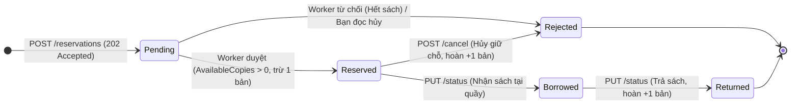

# Hệ thống Thư viện & Đặt mượn Sách Phân tán

[](https://dotnet.microsoft.com/)
[](https://learn.microsoft.com/aspnet/core/fundamentals/minimal-apis)
[](https://www.rabbitmq.com/)
[](https://www.postgresql.org/)
[](https://docs.docker.com/compose/)

Bài tập lớn học phần **Phát triển ứng dụng phân tán — Đề tài số 20**.  
Dự án xây dựng hệ thống quản lý danh mục sách và xử lý yêu cầu đặt mượn bất đồng bộ qua hàng đợi thông điệp, ngăn chặn tình trạng tranh chấp tồn kho (*Overbooking*) khi nhiều bạn đọc đặt cùng một cuốn sách tại cùng thời điểm.

---

## 1. Bài toán & Giải pháp kiến trúc

Ở mô hình đồng bộ truyền thống, thao tác kiểm tra số bản còn lại và trừ tồn kho diễn ra trực tiếp ngay trong luồng HTTP request. Khi nhiều người dùng cùng đặt cuốn sách cuối cùng, hệ thống dễ gặp lỗi đọc trùng số lượng khả dụng (*Race Condition*) hoặc nghẽn khóa dòng cơ sở dữ liệu.

Hệ thống này tách quy trình thành hai giai đoạn độc lập:

1. **Tiếp nhận không chặn (`Library.API`):** Kiểm tra hợp lệ đầu sách/bạn đọc, tạo phiếu ở trạng thái `Pending` kèm mã truy vết `CorrelationId`, đẩy thông điệp bền vững vào **RabbitMQ** và trả ngay `HTTP 202 Accepted` cho người dùng.
2. **Xét duyệt tuần tự (`Library.Worker`):** Tiêu thụ từng thông điệp từ hàng đợi (`Prefetch = 1`), mở giao dịch cô lập `IsolationLevel.Serializable` trên **PostgreSQL**, đối chiếu số bản khả dụng (`AvailableCopies`) để xác nhận giữ chỗ (`Reserved`) hoặc từ chối (`Rejected`).


### Quy hoạch các dịch vụ trong `docker-compose.yml`

| Dịch vụ | Container | Cổng Host | Cổng Nội bộ | Chức năng & Địa chỉ truy cập |
| :--- | :--- | :---: | :---: | :--- |
| **Web Client** | `library_web_client` | `8088` | `8080` | Giao diện Web cho bạn đọc, thủ thư & Reverse Proxy (`http://localhost:8088`) |
| **Console Client** | `library_console_client` | Interactive | — | Ứng dụng CLI 9 chức năng (`docker compose --profile cli run --rm console-client`) |
| **Library API** | `library_api` | `5005` | `5000` | Minimal API, Swagger (`http://localhost:5005/swagger`), Health (`http://localhost:5005/health`) |
| **Reservation Worker** | `library_reservation_worker` | Background | — | Tiến trình ngầm tiêu thụ RabbitMQ, kiểm kê tồn kho & tự phục hồi đơn chờ |
| **RabbitMQ Broker** | `library_rabbitmq` | `5672` | `5672` | Hàng đợi AMQP (`library.exchange` & `library.reservations.dlq`) |
| **RabbitMQ UI** | `library_rabbitmq` | `15672` | `15672` | Trang quản lý hàng đợi (`http://localhost:15672` — tài khoản `guest` / `guest`) |
| **PostgreSQL 16** | `library_postgres` | `5432` | `5432` | Cơ sở dữ liệu `library_db` (`postgres` / `postgrespassword`) |

---

## 2. Vòng đời phiếu mượn & Cơ chế chịu lỗi

### Sơ đồ chuyển đổi trạng thái (`ReservationStatus`)



### Các cơ chế đảm bảo độ tin cậy đã triển khai

- **Idempotent Consumer:** Trước khi trừ tồn kho, Worker luôn kiểm tra trạng thái hiện tại của phiếu; nếu phiếu đã khác `Pending` (do nhận lặp bản tin), Worker bỏ qua an toàn và không trừ kho lần hai.
- **Retry lùi mũ & Dead Letter Queue (`DLQ`):** Khi gặp lỗi kết nối tạm thời, Worker đọc header `x-retry-count` và thử lại tối đa 3 lần (độ trễ `1s`, `2s`, `4s`). Nếu vẫn lỗi hoặc gói JSON không hợp lệ, bản tin được chuyển sang `library.reservations.dlq`.
- **Quét phục hồi đơn `Pending` tồn đọng:** Mỗi 15 giây, Worker tự động kiểm tra các bản ghi `Pending` tồn tại quá hạn trong cơ sở dữ liệu (trường hợp RabbitMQ tạm ngắt kết nối đúng lúc API lưu phiếu) để xử lý bù.
- **Truy vết `X-Correlation-ID` & Health Check thực tế:** Gắn mã định danh xuyên suốt từ HTTP header, cơ sở dữ liệu, thuộc tính AMQP tới log hệ thống; endpoint `/health` kiểm tra trực tiếp kết nối sống tới cả PostgreSQL và RabbitMQ.

---

## 3. Cấu trúc thư mục

```text
distributed-library-reservation-v2/
├── docs/assets/
│   └── architecture.svg               # Sơ đồ kỹ thuật hệ thống
├── src/
│   ├── Library.Domain/                # Thực thể Book, User, Reservation & Message Contract
│   ├── Library.Infrastructure/        # LibraryDbContext, ReservationService, RabbitMqPublisher
│   ├── Library.API/                   # ASP.NET Core Minimal API, Swagger, Health Check
│   ├── Library.Worker/                # BackgroundService xử lý hàng đợi, Retry, DLQ & Sweep
│   ├── Library.WebClient/             # Reverse Proxy & Giao diện Web (wwwroot/index.html, css, js)
│   └── Library.ConsoleClient/         # Ứng dụng dòng lệnh tương tác & công cụ kiểm thử đồng thời
├── tests/
│   └── Library.Tests/                 # Bộ 8 bài Unit Test (xUnit + EF Core InMemory)
├── docker-compose.yml                 # Cấu hình khởi chạy toàn bộ hệ thống
├── start-windows.bat                  # Kịch bản khởi động nhanh trên Windows
├── stop-windows.bat                   # Kịch bản dừng các container Docker
├── run-console-windows.bat            # Kịch bản mở Console Client (hỗ trợ cả SDK lẫn Docker)
├── 20-he-thong-thu-vien-dat-muon-sach.md
├── HUONG-DAN-CHUNG.md
└── BAO-CAO-BAI-TAP-LON.md             # Báo cáo chi tiết bài tập lớn
```

---

## 4. Hướng dẫn cài đặt & Chạy hệ thống

### Cách 1: Khởi chạy bằng Docker Compose (Khuyên dùng)

Yêu cầu máy tính đã cài đặt và bật sẵn **Docker Desktop** (hoặc Docker Engine trên Linux).

```bash
git clone https://github.com/azmedia2006/distributed-library-reservation-v2.git
cd distributed-library-reservation-v2
docker compose up -d --build
```

Trên Windows, có thể chạy trực tiếp bằng cách nhấp đúp tệp **`start-windows.bat`** (tự động build, chạy các dịch vụ và mở trình duyệt tới cổng `8088`). Khi muốn dừng hệ thống, chạy **`stop-windows.bat`** hoặc lệnh `docker compose down`.

- **Giao diện Web:** http://localhost:8088
- **Tài liệu Swagger API:** http://localhost:5005/swagger
- **RabbitMQ Management:** http://localhost:15672 (`guest` / `guest`)

### Cách 2: Chạy trực tiếp trên môi trường phát triển (.NET 10 SDK)

1. Khởi động PostgreSQL và RabbitMQ qua Docker:
   ```bash
   docker compose up -d postgres-db rabbitmq
   ```
2. Chạy từng tiến trình trên các cửa sổ dòng lệnh riêng biệt:
   ```bash
   dotnet run --project src/Library.API
   dotnet run --project src/Library.Worker
   dotnet run --project src/Library.WebClient
   dotnet run --project src/Library.ConsoleClient
   ```

---

## 5. Danh sách RESTful API

| Phương thức | Đường dẫn | Mô tả chức năng | Mã phản hồi |
| :---: | :--- | :--- | :---: |
| `GET` | `/books` | Danh sách sách, hỗ trợ tìm kiếm `?search=` và lọc `?availableOnly=true` | `200 OK` |
| `GET` | `/books/{id}` | Thông tin chi tiết sách, số bản khả dụng và số phiếu đang giữ/mượn | `200 OK`, `404` |
| `POST` | `/books` | Thêm đầu sách mới vào kho thư viện | `201 Created` |
| `PUT` | `/books/{id}` | Cập nhật thông tin sách và điều chỉnh tổng số bản (`TotalCopies`) | `200 OK`, `400` |
| `POST` | `/reservations` | Gửi yêu cầu đặt mượn sách (`Pending`) và đẩy vào RabbitMQ | `202 Accepted` |
| `GET` | `/reservations` | Danh sách toàn bộ phiếu mượn hệ thống (`?status=&search=`) | `200 OK` |
| `GET` | `/reservations/{id}` | Tra cứu chi tiết trạng thái, mốc thời gian và `CorrelationId` của phiếu | `200 OK`, `404` |
| `GET` | `/users/{userId}/reservations` | Tra cứu sách đang đặt/mượn (`?activeOnly=true`) hoặc lịch sử của bạn đọc | `200 OK`, `404` |
| `PUT` | `/reservations/{id}/status` | Xác nhận nhận sách (`Borrowed`) hoặc trả lại sách (`Returned`) | `200 OK`, `400` |
| `POST` | `/reservations/{id}/cancel` | Hủy phiếu đang `Pending` / `Reserved` (hoàn lại số bản nếu đã giữ chỗ) | `200 OK`, `400` |
| `GET` | `/users` | Danh sách thẻ bạn đọc | `200 OK` |
| `POST` | `/users` | Đăng ký thẻ bạn đọc mới | `201 Created` |
| `GET` | `/stats` | Số liệu thống kê tổng quan kho sách và phiếu mượn | `200 OK` |
| `GET` | `/health` | Kiểm tra tình trạng kết nối tới PostgreSQL và RabbitMQ | `200 OK` |

---

## 6. Kiểm thử & Kịch bản nghiệm thu

### Chạy bộ kiểm thử tự động (`xUnit`)

```bash
dotnet test
```

Project `tests/Library.Tests` gồm 8 bài kiểm thử đơn vị gọi trực tiếp vào `ReservationService`:
- Duyệt giữ sách thành công và giảm `AvailableCopies` khi còn bản trên kệ.
- Từ chối phiếu (`Rejected`) khi `AvailableCopies == 0`.
- Bỏ qua thông điệp lặp lại (*Idempotency*), đảm bảo không trừ kho hai lần.
- Chuyển trạng thái hợp lệ `Reserved -> Borrowed` và `Borrowed -> Returned` (cộng hoàn trả `+1` bản).
- Chặn thao tác chuyển trạng thái sai thứ tự (`Pending -> Borrowed`).
- Hủy phiếu `Reserved` tự động hoàn trả lại bản sách khả dụng.
- Xử lý 5 yêu cầu gửi đồng thời cho đầu sách chỉ còn 1 bản: chỉ duyệt 1 phiếu `Reserved`, từ chối 4 phiếu `Rejected`, tồn kho cuối bằng `0`.

### Kịch bản kiểm chứng trực tiếp trên giao diện Web (`http://localhost:8088`)

1. **Đặt mượn và trả sách thông thường:** Chọn bạn đọc ở góc phải trên cùng, nhấn **Đặt mượn sách** -> phiếu chuyển từ `Chờ duyệt` sang `Đã giữ sách` -> nhấn **Xác nhận nhận sách** (`Đang mượn`) -> nhấn **Trả lại sách** (`Đã trả`), số bản trên kệ tự động tăng lại.
2. **Kiểm chứng chống Overbooking:** Ở cuốn sách chỉ còn 1 quyển (*Building Microservices*), bấm **Gửi nhanh 3 phiếu** để gửi song song 3 request lên API. Hệ thống chỉ xác nhận giữ sách cho 1 phiếu đầu tiên và tự động từ chối 2 phiếu sau.
3. **Kiểm chứng khả năng phục hồi khi Worker tạm dừng:** Chạy `docker compose stop reservation-worker`, tiếp tục đặt sách trên Web (phiếu được giữ ở trạng thái `Chờ duyệt`). Khi chạy lại `docker compose start reservation-worker`, Worker tự kết nối lại và xử lý hết các phiếu đang chờ.
