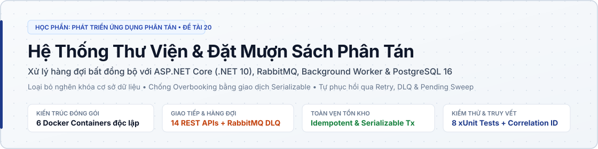
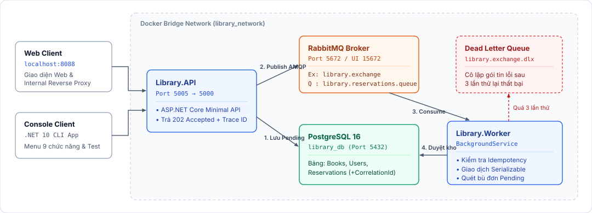
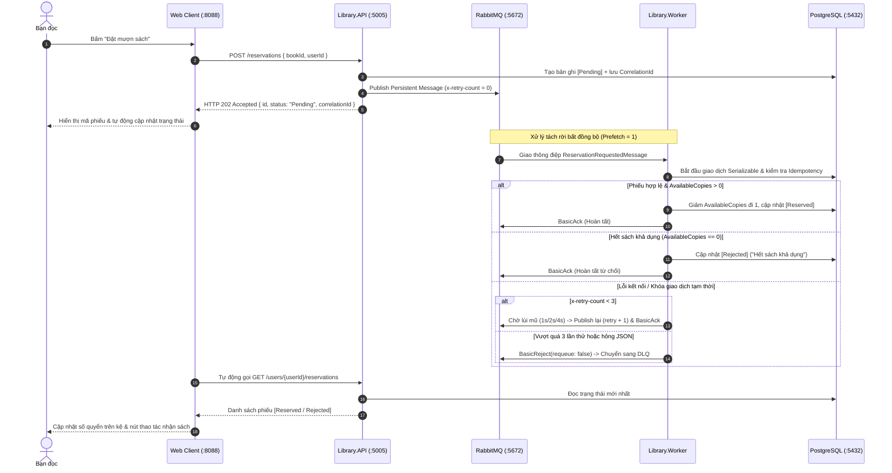
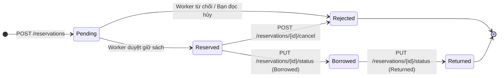
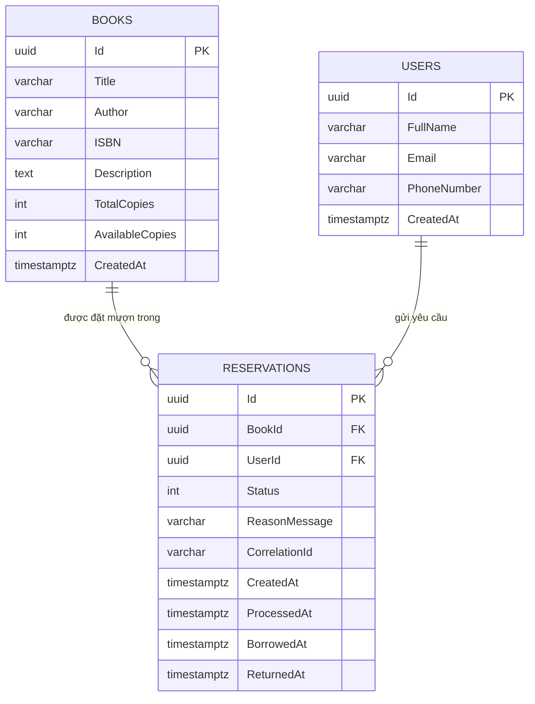
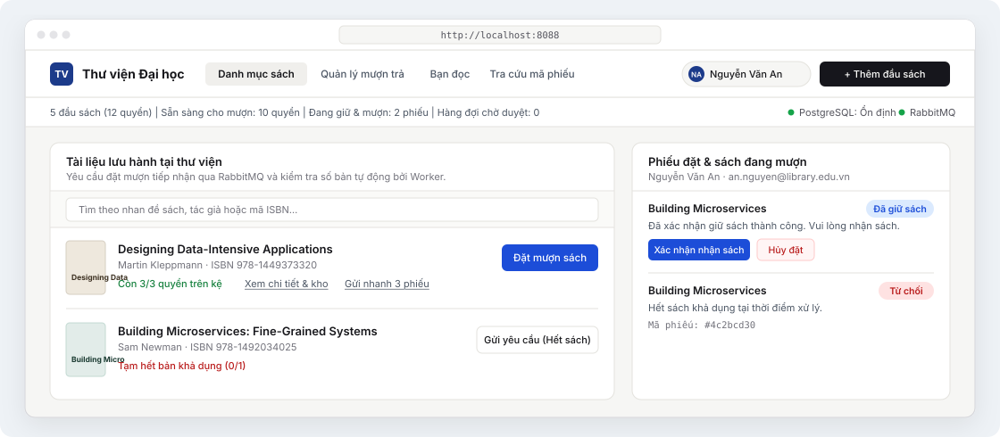

<div align="center">
  

  <br/>

  <p>
    <a href="https://dotnet.microsoft.com/"></a>
    <a href="https://learn.microsoft.com/dotnet/csharp/"></a>
    <a href="https://learn.microsoft.com/aspnet/core/fundamentals/minimal-apis"></a>
    <a href="https://www.rabbitmq.com/"></a>
    <a href="https://www.postgresql.org/"></a>
    <a href="https://docs.docker.com/compose/"></a>
    <a href="https://xunit.net/"></a>
  </p>

  <p>
    <a href="#1-bài-toán--đối-chiếu-mô-hình-kiến-trúc">Bài toán</a> •
    <a href="#2-kiến-trúc-hệ-thống--quy-hoạch-hạ-tầng">Kiến trúc</a> •
    <a href="#3-luồng-xử-lý-bất-đồng-bộ--máy-trạng-thái">Luồng xử lý</a> •
    <a href="#4-thiết-kế-cơ-sở-dữ-liệu--dữ-liệu-khởi-tạo">Database</a> •
    <a href="#5-các-cơ-chế-kỹ-thuật-phân-tán--chịu-lỗi">Chịu lỗi</a> •
    <a href="#6-giao-diện-người-dùng-web--console-cli">Giao diện</a> •
    <a href="#8-đặc-tả-chi-tiết-restful-api">API</a> •
    <a href="#9-hướng-dẫn-cài-đặt-kiểm-thử--kịch-bản-bảo-vệ">Cài đặt & Demo</a>
  </p>
</div>

---

> [!NOTE]
> **Thông tin đồ án:** Bài tập lớn học phần **Phát triển ứng dụng phân tán — Đề tài số 20**.  
> Tài liệu yêu cầu gốc xem tại [20-he-thong-thu-vien-dat-muon-sach.md](./20-he-thong-thu-vien-dat-muon-sach.md), quy định kỹ thuật chung tại [HUONG-DAN-CHUNG.md](./HUONG-DAN-CHUNG.md) và quyển thuyết minh chi tiết tại [BAO-CAO-BAI-TAP-LON.md](./BAO-CAO-BAI-TAP-LON.md).

---

## Mục lục

1. [Bài toán & Đối chiếu mô hình kiến trúc](#1-bài-toán--đối-chiếu-mô-hình-kiến-trúc)
2. [Kiến trúc hệ thống & Quy hoạch hạ tầng](#2-kiến-trúc-hệ-thống--quy-hoạch-hạ-tầng)
3. [Luồng xử lý bất đồng bộ & Máy trạng thái](#3-luồng-xử-lý-bất-đồng-bộ--máy-trạng-thái)
4. [Thiết kế cơ sở dữ liệu & Dữ liệu khởi tạo](#4-thiết-kế-cơ-sở-dữ-liệu--dữ-liệu-khởi-tạo)
5. [Các cơ chế kỹ thuật phân tán & Chịu lỗi](#5-các-cơ-chế-kỹ-thuật-phân-tán--chịu-lỗi)
6. [Giao diện người dùng (Web & Console CLI)](#6-giao-diện-người-dùng-web--console-cli)
7. [Cấu trúc thư mục & Biến môi trường](#7-cấu-trúc-thư-mục--biến-môi-trường)
8. [Đặc tả chi tiết RESTful API](#8-đặc-tả-chi-tiết-restful-api)
9. [Hướng dẫn cài đặt, Kiểm thử & Kịch bản bảo vệ](#9-hướng-dẫn-cài-đặt-kiểm-thử--kịch-bản-bảo-vệ)

---

## 1. Bài toán & Đối chiếu mô hình kiến trúc

Trong hệ thống quản lý thư viện đại học, các đầu sách giáo trình trọng điểm thường có số lượng bản in giới hạn nhưng lại nhận hàng trăm lượt đặt mượn cùng thời điểm (đầu học kỳ hoặc mùa thi). Nếu xử lý đồng bộ trực tiếp trên luồng HTTP, hệ thống dễ phát sinh lỗi tranh chấp dữ liệu hoặc nghẽn kết nối cơ sở dữ liệu.

| Tiêu chí kỹ thuật | Mô hình đồng bộ truyền thống (Synchronous) | Mô hình phân tán bất đồng bộ trong dự án (Event-Driven) |
| :--- | :--- | :--- |
| **Độ trễ phản hồi HTTP** | Cao khi tải lớn do Client phải chờ khóa dòng và cập nhật kho xong mới nhận phản hồi. | Thấp và ổn định: API ghi nhận phiếu `Pending` và trả ngay `202 Accepted`. |
| **Chống Overbooking** | Dễ xảy ra *Race Condition* nếu nhiều giao dịch đọc cùng giá trị `AvailableCopies > 0`. | `Library.Worker` tiêu thụ tuần tự (`Prefetch = 1`) kết hợp giao dịch `Serializable` ngăn âm kho. |
| **Chịu tải đột biến (Spike)** | Vỡ kết nối (Connection Pool Exhaustion) khi lượng request vượt ngưỡng xử lý của DB. | **RabbitMQ** đóng vai trò bộ đệm điều tiết lưu lượng (*Load Leveling*). |
| **Khi dịch vụ xử lý tạm dừng** | Toàn bộ chức năng đặt mượn báo lỗi `500` ngay lập tức. | API vẫn tiếp nhận đơn bình thường; khi Worker chạy lại sẽ tự động tiêu thụ hàng đợi tồn đọng. |
| **Xử lý lỗi tạm thời & gói tin hỏng** | Lỗi ngoại lệ trả thẳng về người dùng, không có cơ chế thử lại tự động. | Tự động **Retry 3 lần** (`1s`, `2s`, `4s`) trước khi cô lập vào **Dead Letter Queue (`DLQ`)**. |
| **Truy vết xuyên dịch vụ** | Log rời rạc, khó đối chiếu khi tách nhiều tiến trình. | Gắn mã `X-Correlation-ID` xuyên suốt từ Web/CLI -> API -> PostgreSQL -> RabbitMQ -> Worker. |

---

## 2. Kiến trúc hệ thống & Quy hoạch hạ tầng



### 2.1. Quy hoạch 6 dịch vụ trong `docker-compose.yml`

Toàn bộ các container giao tiếp nội bộ với nhau thông qua tên dịch vụ (*service name*) trên mạng cầu nối riêng `library_network`:

| Dịch vụ | Container Name | Cổng Host | Cổng Nội bộ | Vai trò & Địa chỉ truy cập |
| :--- | :--- | :---: | :---: | :--- |
| **Web Client** | `library_web_client` | `8088` | `8080` | Giao diện Web 4 phân hệ & Internal Reverse Proxy (`http://localhost:8088`) |
| **Console Client** | `library_console_client` | Interactive | — | Ứng dụng dòng lệnh 9 chức năng (`docker compose --profile cli run --rm console-client`) |
| **Library API** | `library_api` | `5005` | `5000` | Minimal API, Swagger (`http://localhost:5005/swagger`), Health (`http://localhost:5005/health`) |
| **Reservation Worker** | `library_reservation_worker` | Background | — | Tiến trình ngầm tiêu thụ AMQP, xét duyệt kho, Retry x3, DLQ & quét phục hồi đơn `Pending` |
| **RabbitMQ Broker** | `library_rabbitmq` | `5672` | `5672` | Máy chủ hàng đợi thông điệp theo giao thức AMQP 0-9-1 |
| **RabbitMQ UI** | `library_rabbitmq` | `15672` | `15672` | Giao diện giám sát Exchange/Queue (`http://localhost:15672` — `guest` / `guest`) |
| **PostgreSQL 16** | `library_postgres` | `5432` | `5432` | Cơ sở dữ liệu quan hệ `library_db` (`postgres` / `postgrespassword`) |

### 2.2. Cấu hình Topology trên RabbitMQ

Cả `RabbitMqPublisher` (phía API) và `Worker` (phía Consumer) đều tự động khai báo cấu trúc hàng đợi bền vững (`durable: true`) ngay khi khởi tạo kết nối:

| Thành phần AMQP | Tên định danh | Loại / Tham số cấu hình | Mục đích sử dụng |
| :--- | :--- | :--- | :--- |
| **Main Exchange** | `library.exchange` | `Direct`, `durable: true` | Nhận thông điệp đặt mượn mới từ `Library.API`. |
| **Main Queue** | `library.reservations.queue` | `durable: true`, gắn `x-dead-letter-exchange` & `x-dead-letter-routing-key` | Lưu trữ bền vững các yêu cầu chờ `Library.Worker` xử lý. |
| **Routing Key** | `reservation.created` | Khóa định tuyến chính | Định tuyến bản tin từ `library.exchange` vào `library.reservations.queue`. |
| **Dead Letter Exchange** | `library.exchange.dlx` | `Direct`, `durable: true` | Tiếp nhận các thông điệp bị Worker từ chối (`BasicReject(requeue: false)`). |
| **Dead Letter Queue** | `library.reservations.dlq` | `durable: true` (`reservation.deadletter`) | Lưu giữ bản tin lỗi quá 3 lần thử hoặc sai định dạng JSON để kiểm tra hậu kiểm. |

---

## 3. Luồng xử lý bất đồng bộ & Máy trạng thái

### 3.1. Sơ đồ tuần tự xử lý yêu cầu đặt mượn



### 3.2. Máy trạng thái vòng đời phiếu mượn (`ReservationStatus`)



### 3.3. Quy tắc chuyển trạng thái & Biến động tồn kho (`AvailableCopies`)

| Trạng thái nguồn | Thao tác / Tác nhân | Trạng thái đích | Tác động tới `AvailableCopies` | Ghi chú thời gian cập nhật |
| :--- | :--- | :--- | :---: | :--- |
| *(Khởi tạo)* | `POST /reservations` (`Library.API`) | `Pending` (`0`) | Không đổi (`0`) | Ghi nhận `CreatedAt` (UTC) |
| `Pending` | `Library.Worker` kiểm tra còn sách | `Reserved` (`1`) | **Giảm `-1`** | Ghi nhận `ProcessedAt` (UTC) |
| `Pending` | `Library.Worker` kiểm tra hết sách | `Rejected` (`2`) | Không đổi (`0`) | Ghi nhận `ProcessedAt` (UTC) |
| `Pending` | `POST /reservations/{id}/cancel` | `Rejected` (`2`) | Không đổi (`0`) | Hủy trước khi trừ kho |
| `Reserved` | `POST /reservations/{id}/cancel` | `Rejected` (`2`) | **Hoàn lại `+1`** | Giải phóng bản sách đang giữ chỗ |
| `Reserved` | `PUT /reservations/{id}/status` | `Borrowed` (`3`) | Không đổi (`0`) | Ghi nhận `BorrowedAt` (đã trừ lúc giữ chỗ) |
| `Borrowed` | `PUT /reservations/{id}/status` | `Returned` (`4`) | **Hoàn lại `+1`** | Ghi nhận `ReturnedAt` (tối đa bằng `TotalCopies`) |

---

## 4. Thiết kế cơ sở dữ liệu & Dữ liệu khởi tạo

### 4.1. Sơ đồ quan hệ thực thể (`PostgreSQL 16` — `library_db`)



Các chỉ mục (*Indexes*) tối ưu truy vấn đã được khai báo trong `LibraryDbContext`:
- `IX_Books_ISBN`: Tăng tốc tìm kiếm đầu sách theo mã ISBN.
- `IX_Reservations_UserId_Status`: Tăng tốc lọc danh sách sách đang đặt/mượn của từng bạn đọc.
- `IX_Reservations_Status_CreatedAt`: Phục vụ luồng quét đơn `Pending` tồn đọng của Worker và bảng quản trị của thủ thư.

### 4.2. Dữ liệu khởi tạo tự động (Seed Data)

Khi khởi chạy lần đầu, hệ thống tự động tạo schema và nạp sẵn **3 thẻ bạn đọc** cùng **5 đầu sách chuyên ngành** có mã GUID cố định để thuận tiện kiểm thử nhanh trên cả Web, Console CLI và Swagger:

<details>
<summary><b>Xem bảng mã GUID mẫu của Bạn đọc & Đầu sách</b></summary>

<br/>

**Danh sách bạn đọc khởi tạo sẵn:**

| Họ và tên | Email | Số điện thoại | Mã `UserId` cố định |
| :--- | :--- | :---: | :--- |
| Nguyễn Văn An | `an.nguyen@library.edu.vn` | `0901234567` | `11111111-1111-1111-1111-111111111111` |
| Trần Thị Bình | `binh.tran@library.edu.vn` | `0912345678` | `22222222-2222-2222-2222-222222222222` |
| Lê Hoàng Cường | `cuong.le@library.edu.vn` | `0987654321` | `33333333-3333-3333-3333-333333333333` |

**Danh mục đầu sách khởi tạo sẵn:**

| Nhan đề sách | Tác giả | Số bản | Mã `BookId` cố định |
| :--- | :--- | :---: | :--- |
| *Designing Data-Intensive Applications* | Martin Kleppmann | `3` | `aaaaaaaa-aaaa-aaaa-aaaa-aaaaaaaaaaaa` |
| *Distributed Systems: Principles and Paradigms* | A. Tanenbaum, M. van Steen | `2` | `bbbbbbbb-bbbb-bbbb-bbbb-bbbbbbbbbbbb` |
| *Building Microservices: Fine-Grained Systems* | Sam Newman | **`1`** *(Dùng test Overbooking)* | `cccccccc-cccc-cccc-cccc-cccccccccccc` |
| *Clean Architecture: A Craftsman's Guide* | Robert C. Martin | `4` | `dddddddd-dddd-dddd-dddd-dddddddddddd` |
| *Enterprise Integration Patterns* | Gregor Hohpe, Bobby Woolf | `2` | `eeeeeeee-eeee-eeee-eeee-eeeeeeeeeeee` |

</details>

---

## 5. Các cơ chế kỹ thuật phân tán & Chịu lỗi

1. **Tầng dịch vụ nghiệp vụ dùng chung (`ReservationService`):**  
   Toàn bộ logic xét duyệt tồn kho, bàn giao sách, thu hồi sách và hủy đặt chỗ được tách riêng tại project `Library.Infrastructure`, sử dụng thống nhất cho `Library.API`, `Library.Worker` và bộ kiểm thử `Library.Tests`.
2. **Khóa an toàn đa luồng trên kênh AMQP (`RabbitMqPublisher`):**  
   Trong `RabbitMQ.Client`, đối tượng `IModel` không an toàn khi nhiều luồng HTTP cùng gọi `BasicPublish`. Hệ thống đồng bộ hóa vùng tới hạn bằng `lock`, đảm bảo việc bắn hàng chục request song song không bao giờ làm hỏng frame AMQP.
3. **Giao dịch `Serializable` & Idempotent Consumer:**  
   Worker kiểm tra `reservation.Status != Pending` để loại bỏ nguy cơ trừ kho lặp khi nhận tin nhắn trùng (*At-least-once delivery*), đồng thời bao bọc thao tác kiểm tra — trừ bản sách trong giao dịch `IsolationLevel.Serializable`.
4. **Cơ chế tự phục hồi hai lớp (Retry + Pending Outbox Sweep):**  
   - **Lớp 1 (Tại hàng đợi):** Lỗi tạm thời được thử lại tối đa 3 lần với độ trễ lùi mũ `1s -> 2s -> 4s` trước khi chuyển sang `library.reservations.dlq`.
   - **Lớp 2 (Tại cơ sở dữ liệu):** Định kỳ mỗi `15 giây`, Worker rà soát các phiếu `Pending` tạo quá 15 giây mà chưa được xử lý (ví dụ khi RabbitMQ vừa khởi động lại đúng thời điểm nhận đơn) để tự động duyệt bù, không làm rơi yêu cầu nào của bạn đọc.
5. **Internal Reverse Proxy tại `Library.WebClient`:**  
   Trình duyệt của người dùng chỉ giao tiếp với `WebClient` (`:8088/api/*`), sau đó `WebClient` chuyển tiếp sang `http://library-api:5000` qua mạng Docker nội bộ và giữ nguyên header `X-Correlation-ID`, triệt tiêu hoàn toàn lỗi CORS khi triển khai thực tế.

---

## 6. Giao diện người dùng (Web & Console CLI)

### 6.1. Giao diện Web (`http://localhost:8088`)



Giao diện Web được tổ chức tách biệt rõ mã nguồn HTML (`index.html`), bảng kiểu (`css/styles.css`) và logic tương tác (`js/app.js`) gồm 4 phân hệ:
- **Danh mục sách:** Tìm kiếm tức thì theo tên sách/tác giả/ISBN, lọc sách còn bản trên kệ, xem ngăn trượt chi tiết tồn kho, đặt mượn đơn lẻ, gửi nhanh 3 phiếu đồng thời và theo dõi danh sách phiếu cá nhân tự động cập nhật khi Worker duyệt xong.
- **Quản lý mượn trả:** Bảng điều phối tập trung dành cho thủ thư lọc theo từng trạng thái (`Chờ duyệt`, `Đã giữ sách`, `Đang mượn`, `Đã trả`, `Từ chối`), tìm theo `Correlation ID`, bấm giao sách hoặc nhận trả 1-click.
- **Bạn đọc:** Quản lý danh sách thẻ độc giả, đăng ký thẻ mới và chuyển đổi nhanh tài khoản thao tác.
- **Tra cứu mã phiếu:** Kiểm tra chi tiết 4 chặng thời gian xử lý của một mã GUID bất kỳ kèm khung xem dữ liệu JSON gốc từ máy chủ.

### 6.2. Ứng dụng dòng lệnh `Library.ConsoleClient`

Dành cho kiểm thử nhanh trên môi trường terminal với menu 9 chức năng tương tác:
1. Tra cứu danh sách sách & lọc theo từ khóa / tình trạng còn bản.
2. Xem chi tiết đầu sách & thống kê số phiếu đang giữ/mượn.
3. Xem danh sách bạn đọc & đăng ký bạn đọc mới.
4. Gửi yêu cầu đặt mượn sách bất đồng bộ qua RabbitMQ.
5. Tra cứu trạng thái & mã `CorrelationId` của đơn đặt mượn.
6. Tra cứu sách đang đặt/mượn (`activeOnly`) hoặc toàn bộ lịch sử của bạn đọc.
7. Cập nhật trạng thái Nhận sách (`Borrowed`), Trả sách (`Returned`) hoặc Hủy đơn.
8. Kiểm tra tình trạng kết nối hạ tầng (`/health`) & thống kê tổng hợp (`/stats`).
9. **Công cụ Burst Concurrency Test:** Tự động bắn song song `N` yêu cầu đặt mượn vào cùng một cuốn sách, chờ Worker xử lý xong và in bảng tổng kết số phiếu duyệt / số phiếu từ chối / tồn kho cuối cùng.

---

## 7. Cấu trúc thư mục & Biến môi trường

### 7.1. Cây thư mục dự án

```text
distributed-library-reservation-v2/
├── docs/assets/                        # Hình minh họa SVG (banner, architecture, web-preview)
├── src/
│   ├── Library.Domain/
│   │   └── Entities.cs                 # Thực thể Book, User, Reservation & Message Contract
│   ├── Library.Infrastructure/
│   │   ├── LibraryDbContext.cs         # EF Core DbContext, Fluent Indexes & Seed Data
│   │   ├── RabbitMqConstants.cs        # Hằng số Exchange, Queue, Routing Key & DLQ
│   │   ├── RabbitMqPublisher.cs        # Thread-safe AMQP Publisher & Health Check
│   │   └── ReservationService.cs       # Nghiệp vụ xét duyệt kho, mượn trả & hủy phiếu
│   ├── Library.API/
│   │   ├── Program.cs                  # 14 Minimal API Endpoints & Correlation ID Middleware
│   │   └── Dockerfile                  # Multi-stage Dockerfile cho dịch vụ API
│   ├── Library.Worker/
│   │   ├── Worker.cs                   # Async Consumer, Exponential Retry, DLQ & Recovery Sweep
│   │   ├── Program.cs                  # Khởi tạo Host & kết nối PostgreSQL
│   │   └── Dockerfile                  # Multi-stage Dockerfile cho dịch vụ Worker
│   ├── Library.WebClient/
│   │   ├── Program.cs                  # Static File Server & Internal Reverse Proxy
│   │   ├── Dockerfile                  # Multi-stage Dockerfile cho dịch vụ Web
│   │   └── wwwroot/                    # Giao diện Web tách module (index.html, css/, js/)
│   └── Library.ConsoleClient/
│       ├── Program.cs                  # Ứng dụng CLI 9 chức năng & Burst Test
│       └── Dockerfile                  # Multi-stage Dockerfile cho ứng dụng Console
├── tests/
│   └── Library.Tests/
│       └── ReservationProcessingTests.cs # 8 kịch bản Unit Test (xUnit + EF Core InMemory)
├── docker-compose.yml                  # Điều phối trọn gói 6 container & volume dữ liệu
├── LibraryDistributedSystem.slnx       # Tệp Solution .NET 10
├── start-windows.bat                   # Kịch bản khởi chạy nhanh 1-click trên Windows
├── stop-windows.bat                    # Kịch bản dừng toàn bộ hệ thống trên Windows
├── run-console-windows.bat             # Kịch bản mở Console Client (tự chuyển Docker nếu thiếu SDK)
├── 20-he-thong-thu-vien-dat-muon-sach.md
├── HUONG-DAN-CHUNG.md
└── BAO-CAO-BAI-TAP-LON.md
```

### 7.2. Danh mục biến môi trường cấu hình

Mọi tham số kết nối đều được tách khỏi mã nguồn theo đúng yêu cầu trong `HUONG-DAN-CHUNG.md`:

| Biến môi trường | Dịch vụ sử dụng | Giá trị mặc định (Docker Compose) | Ý nghĩa |
| :--- | :--- | :--- | :--- |
| `ConnectionStrings__LibraryDb` | `Library.API`, `Library.Worker` | `Host=postgres-db;Port=5432;Database=library_db;...` | Chuỗi kết nối tới cơ sở dữ liệu PostgreSQL 16. |
| `RabbitMQ__Host` | `Library.API`, `Library.Worker` | `rabbitmq` *(Local: `localhost`)* | Tên máy chủ hoặc container của RabbitMQ Broker. |
| `RabbitMQ__Port` | `Library.API`, `Library.Worker` | `5672` | Cổng kết nối AMQP. |
| `RabbitMQ__UserName` / `Password` | `Library.API`, `Library.Worker` | `guest` / `guest` | Tài khoản xác thực RabbitMQ. |
| `ApiUrl` | `Library.WebClient` | `http://library-api:5000` | Địa chỉ đích để Reverse Proxy chuyển tiếp yêu cầu API. |
| `API_BASE_URL` | `Library.ConsoleClient` | `http://localhost:5005` *(Docker: `http://library-api:5000`)* | Địa chỉ máy chủ API mà ứng dụng CLI gọi tới. |

---

## 8. Đặc tả chi tiết RESTful API

Hệ thống cung cấp đầy đủ **5 API bắt buộc** trong đề bài số 20 cùng **9 API quản trị & giám sát mở rộng**:

| Nhóm | Phương thức | Endpoint | Mô tả chi tiết | Mã HTTP |
| :--- | :---: | :--- | :--- | :---: |
| **Sách** | `GET` | `/books` | Danh sách đầu sách (`?search=từ_khóa&availableOnly=true`) | `200` |
| **Sách** | `GET` | `/books/{id}` | Chi tiết sách, số bản khả dụng và thống kê phiếu đang giữ/mượn | `200`, `404` |
| **Sách** | `POST` | `/books` | Thêm mới một đầu sách vào thư viện | `201`, `400` |
| **Sách** | `PUT` | `/books/{id}` | Cập nhật thông tin hoặc điều chỉnh tổng số bản lưu kho (`TotalCopies`) | `200`, `400` |
| **Đặt mượn** | `POST` | `/reservations` | Tiếp nhận yêu cầu đặt mượn (`Pending`), gửi thông điệp vào RabbitMQ | `202`, `404` |
| **Đặt mượn** | `GET` | `/reservations` | Tra cứu toàn bộ phiếu mượn hệ thống (`?status=Reserved&search=...`) | `200` |
| **Đặt mượn** | `GET` | `/reservations/{id}` | Xem trạng thái xử lý, 4 mốc thời gian và `CorrelationId` của phiếu | `200`, `404` |
| **Đặt mượn** | `PUT` | `/reservations/{id}/status` | Chuyển trạng thái nhận sách (`Borrowed`) hoặc trả sách (`Returned`) | `200`, `400` |
| **Đặt mượn** | `POST` | `/reservations/{id}/cancel` | Hủy phiếu đang `Pending` hoặc `Reserved` (hoàn trả `+1` bản nếu đã giữ) | `200`, `400` |
| **Bạn đọc** | `GET` | `/users` | Danh sách thẻ bạn đọc trong thư viện | `200` |
| **Bạn đọc** | `POST` | `/users` | Đăng ký thẻ bạn đọc mới (kiểm tra trùng địa chỉ Email) | `201`, `400` |
| **Bạn đọc** | `GET` | `/users/{userId}/reservations` | Danh sách sách đang đặt/mượn (`?activeOnly=true`) hoặc lịch sử bạn đọc | `200`, `404` |
| **Giám sát** | `GET` | `/stats` | Số liệu thống kê tổng hợp sách, tồn kho và phân bổ trạng thái phiếu | `200` |
| **Giám sát** | `GET` | `/health` | Trạng thái kết nối trực tiếp tới PostgreSQL 16 và RabbitMQ Broker | `200` |

<details>
<summary><b>Xem ví dụ lệnh gọi API mẫu (curl & JSON Response)</b></summary>

<br/>

**1. Gửi yêu cầu đặt mượn sách bất đồng bộ (`POST /reservations`):**
```bash
curl -X POST http://localhost:5005/reservations \
  -H "Content-Type: application/json" \
  -H "X-Correlation-ID: demo-trace-01" \
  -d '{
    "bookId": "cccccccc-cccc-cccc-cccc-cccccccccccc",
    "userId": "11111111-1111-1111-1111-111111111111"
  }'
```
Phản hồi `202 Accepted`:
```json
{
  "id": "8f1d4b20-9a71-4c2b-9e3d-1b2c3d4e5f60",
  "bookId": "cccccccc-cccc-cccc-cccc-cccccccccccc",
  "bookTitle": "Building Microservices: Designing Fine-Grained Systems",
  "userId": "11111111-1111-1111-1111-111111111111",
  "userName": "Nguyễn Văn An",
  "status": "Pending",
  "createdAt": "2026-11-25T03:00:00Z",
  "correlationId": "demo-trace-01",
  "queued": true,
  "message": "Yêu cầu đặt mượn đã được tiếp nhận và đưa vào hàng đợi RabbitMQ xử lý bất đồng bộ."
}
```

**2. Xác nhận nhận sách hoặc trả sách (`PUT /reservations/{id}/status`):**
```bash
curl -X PUT http://localhost:5005/reservations/8f1d4b20-9a71-4c2b-9e3d-1b2c3d4e5f60/status \
  -H "Content-Type: application/json" \
  -d '{ "newStatus": "Borrowed" }'
```

**3. Kiểm tra tình trạng hạ tầng (`GET /health`):**
```json
{
  "status": "Healthy",
  "database": "Connected",
  "rabbitMq": "Connected",
  "timestamp": "2026-11-25T03:00:05Z"
}
```

</details>

---

## 9. Hướng dẫn cài đặt, Kiểm thử & Kịch bản bảo vệ

### 9.1. Khởi chạy hệ thống

#### Phương án A: Khởi chạy tự động bằng Docker Compose (Khuyến nghị trên cả Windows & Linux)

```bash
git clone https://github.com/azmedia2006/distributed-library-reservation-v2.git
cd distributed-library-reservation-v2
docker compose up -d --build
```

> [!TIP]
> **Dành cho Windows:** Chỉ cần nhấp đúp tệp **`start-windows.bat`** để tự động kiểm tra Docker Desktop, build hệ thống và mở thẳng trình duyệt tới `http://localhost:8088`. Mở thêm ứng dụng dòng lệnh bằng **`run-console-windows.bat`**, và dừng toàn bộ hệ thống bằng **`stop-windows.bat`**.

Theo dõi log xử lý bất đồng bộ kèm `CorrelationId` theo thời gian thực:
```bash
docker compose logs -f library-api reservation-worker
```

#### Phương án B: Chạy trực tiếp từ mã nguồn với .NET 10 SDK

```bash
# Bật PostgreSQL 16 và RabbitMQ trên Docker
docker compose up -d postgres-db rabbitmq

# Mở các cửa sổ Terminal độc lập để chạy từng dịch vụ
dotnet run --project src/Library.API
dotnet run --project src/Library.Worker
dotnet run --project src/Library.WebClient
dotnet run --project src/Library.ConsoleClient
```

### 9.2. Thực thi bộ kiểm thử tự động (`xUnit`)

```bash
dotnet test
```

8 kịch bản trong `tests/Library.Tests/ReservationProcessingTests.cs` kiểm chứng trực tiếp lớp `ReservationService`:
1. `ProcessReservation_WhenBookAvailable_ShouldReserveAndDecreaseCopies` — Còn sách thì duyệt `Reserved` và trừ `1` bản.
2. `ProcessReservation_WhenBookOutOfStock_ShouldRejectReservation` — Hết sách (`AvailableCopies = 0`) thì chuyển `Rejected`.
3. `ProcessReservation_Idempotency_DuplicateMessageShouldNotDeductTwice` — Tin nhắn lặp lại không làm trừ kho hai lần.
4. `UpdateStatus_FromReservedToBorrowed_ShouldSucceed` — Chuyển hợp lệ từ `Reserved` sang `Borrowed`.
5. `UpdateStatus_FromBorrowedToReturned_ShouldRestoreAvailableCopiesUpToTotal` — Trả sách hoàn cộng `+1` bản, không vượt `TotalCopies`.
6. `UpdateStatus_InvalidTransition_PendingToBorrowed_ShouldReturnFailure` — Ngăn chặn nhận sách khi phiếu chưa được Worker duyệt.
7. `CancelReservation_WhenReserved_ShouldRestoreAvailableCopyAndMarkRejected` — Hủy phiếu giữ chỗ tự động hoàn lại bản sách.
8. `ProcessReservation_BurstRequestsForSingleCopy_ShouldApproveExactlyOneAndRejectRest` — Bắn 5 yêu cầu liên tiếp vào cuốn sách chỉ còn 1 bản: duyệt đúng 1 phiếu và từ chối 4 phiếu còn lại.

### 9.3. Bốn kịch bản trình diễn thực tế khi bảo vệ đồ án

1. **Kịch bản 1 — Chu trình đặt mượn & trả sách chuẩn:**  
   Mở `http://localhost:8088`, chọn bạn đọc *Nguyễn Văn An*, bấm **Đặt mượn sách** ở một đầu sách còn bản -> quan sát phiếu tự động chuyển từ `Chờ duyệt` sang `Đã giữ sách` sau ~1 giây -> bấm **Xác nhận nhận sách** (`Đang mượn`) -> bấm **Trả lại sách** (`Đã trả`) và kiểm tra số bản khả dụng tăng trở lại.
2. **Kịch bản 2 — Chống Overbooking khi đặt trùng cuốn sách cuối cùng:**  
   Tại đầu sách *Building Microservices* (chỉ có **1 quyển**), bấm liên kết **Gửi nhanh 3 phiếu** (hoặc dùng mục số `9` trên Console Client). Cả 3 request đều được API nhận `202 Accepted`, sau đó Worker lần lượt duyệt đúng **1 phiếu `Đã giữ sách`** và từ chối **2 phiếu `Từ chối`** (*Hết sách khả dụng*), số bản trên kệ giữ ở `0/1` (không bao giờ âm).
3. **Kịch bản 3 — Khả năng chịu lỗi khi Worker tạm dừng hoạt động:**  
   Chạy lệnh `docker compose stop reservation-worker`. Quay lại giao diện Web đặt thêm 2 cuốn sách: hệ thống không hề báo lỗi, các phiếu được giữ ở trạng thái `Chờ duyệt` và nằm an toàn trong hàng đợi RabbitMQ (`http://localhost:15672`). Tiếp theo chạy `docker compose start reservation-worker`: ngay khi khởi động lên, Worker lập tức tiêu thụ và duyệt toàn bộ các phiếu đang chờ.
4. **Kịch bản 4 — Truy vết phân tán qua `Correlation ID`:**  
   Nhấn vào mã phiếu bất kỳ trên giao diện Web để mở tab **Tra cứu mã phiếu**, sao chép mã `Correlation ID` và tìm trong cửa sổ `docker compose logs` để chứng minh hành trình xuyên suốt của một yêu cầu từ `Library.API` sang `RabbitMQ` và `Library.Worker`.

---

<div align="center">
  <sub>Đề tài số 20 — Học phần Phát triển ứng dụng phân tán • Mã nguồn xây dựng với C#, .NET 10, RabbitMQ & PostgreSQL 16</sub>
</div>
