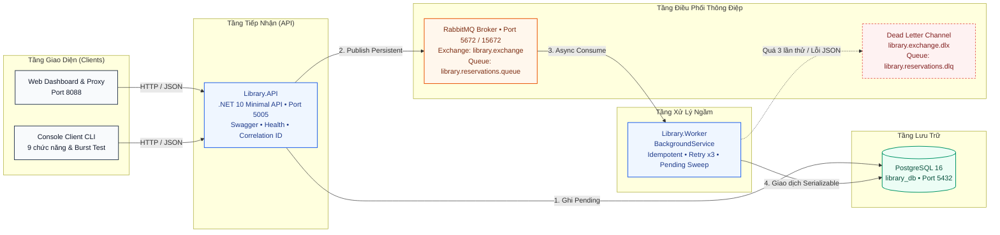
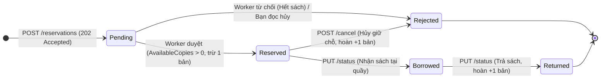
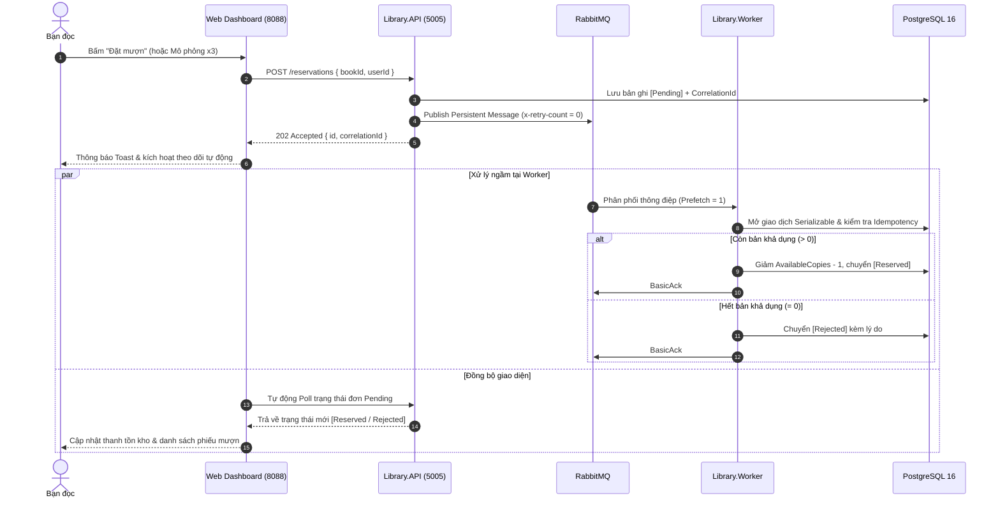

<div align="center">

# Distributed Library Reservation System
### Hệ Thống Thư Viện & Đặt Mượn Sách Phân Tán

<p>
  Kiến trúc hướng sự kiện bất đồng bộ giải quyết bài toán <b>Overbooking</b> và <b>nghẽn khóa cơ sở dữ liệu</b> khi lưu lượng đặt mượn tăng cao đồng thời.
</p>

<p>
  <a href="https://dotnet.microsoft.com/"></a>
  <a href="https://learn.microsoft.com/dotnet/csharp/"></a>
  <a href="https://www.rabbitmq.com/"></a>
  <a href="https://www.postgresql.org/"></a>
  <a href="https://www.docker.com/"></a>
  <a href="https://github.com/azmedia2006/distributed-library-reservation-v2/releases"></a>
</p>

<p>
  <a href="#kiến-trúc-hệ-thống">Kiến trúc</a> •
  <a href="#luồng-xử-lý--vòng-đời-đơn">Luồng xử lý</a> •
  <a href="#điểm-nhấn-kỹ-thuật">Điểm nhấn kỹ thuật</a> •
  <a href="#khởi-chạy-nhanh">Khởi chạy nhanh</a> •
  <a href="#danh-mục-restful-api">API Reference</a> •
  <a href="#kiểm-thử--kịch-bản-bảo-vệ">Kiểm thử & Demo</a>
</p>

</div>

---

> [!IMPORTANT]
> **Học phần:** Phát triển ứng dụng phân tán — **Đề tài số 20**  
> Toàn bộ 6 thành phần (`PostgreSQL`, `RabbitMQ`, `Library.API`, `Library.Worker`, `Library.WebClient`, `Library.ConsoleClient`) đều có `Dockerfile` độc lập, được khai báo đầy đủ trong `docker-compose.yml` và giao tiếp hoàn toàn qua mạng nội bộ `library_network`.

---

## Bài Toán & Định Hướng Thiết Kế

| Vấn đề ở mô hình đồng bộ truyền thống | Giải pháp phân tán trong hệ thống này |
| :--- | :--- |
| **Race Condition & Overbooking:** Nhiều độc giả cùng đặt cuốn sách cuối cùng làm âm tồn kho. | **Serializable Queue Processing:** Worker tiêu thụ tuần tự thông điệp từ RabbitMQ kết hợp giao dịch `IsolationLevel.Serializable`. |
| **Nghẽn cổ chai Database:** Giữ khóa dòng trực tiếp trên luồng HTTP làm treo cả thao tác tra cứu sách. | **Non-blocking `202 Accepted`:** API ghi nhận trạng thái sơ bộ `Pending` và trả phản hồi tức thì dưới vài mili-giây. |
| **Mất đơn khi hạ tầng chập chờn:** Broker hoặc Worker tạm dừng khiến yêu cầu bị đánh rơi. | **Retry + DLQ + Pending Sweep:** Thử lại lùi mũ 3 lần trước khi vào `DLQ`, kết hợp luồng quét phục hồi đơn `Pending` định kỳ. |
| **Khó truy vết lỗi liên dịch vụ:** Không biết một phiếu mượn đi qua API và Worker nào. | **End-to-End `X-Correlation-ID`:** Định danh xuyên suốt từ trình duyệt, API, PostgreSQL, RabbitMQ đến Worker Logs. |

---

## Kiến Trúc Hệ Thống



### Quy hoạch dịch vụ & cổng kết nối

| Dịch vụ | Container Name | Cổng Host | Cổng Nội Bộ | Vai trò & Địa chỉ truy cập |
| :--- | :--- | :---: | :---: | :--- |
| **Web Dashboard** | `library_web_client` | `8088` | `8080` | Giao diện Bạn đọc, Quầy Thủ thư & Reverse Proxy (`http://localhost:8088`) |
| **Console Client CLI** | `library_console_client` | Interactive CLI | — | Ứng dụng dòng lệnh 9 chức năng & Burst Test (`docker compose --profile cli run --rm console-client`) |
| **Library API** | `library_api` | `5005` | `5000` | Minimal API, Swagger (`http://localhost:5005/swagger`), Health (`http://localhost:5005/health`) |
| **Reservation Worker** | `library_reservation_worker` | Background | — | Consumer ngầm xử lý hàng đợi, Retry x3, DLQ & chống Overbooking |
| **RabbitMQ Broker** | `library_rabbitmq` | `5672` | `5672` | Giao thức AMQP 0-9-1 (`library.exchange` & `library.reservations.dlq`) |
| **RabbitMQ Dashboard** | `library_rabbitmq` | `15672` | `15672` | Giao diện quản trị hàng đợi (`http://localhost:15672` — `guest` / `guest`) |
| **PostgreSQL 16** | `library_postgres` | `5432` | `5432` | Cơ sở dữ liệu `library_db` (`postgres` / `postgrespassword`) |

---

## Luồng Xử Lý & Vòng Đời Đơn

### 1. Máy trạng thái phiếu đặt mượn (`ReservationStatus`)



### 2. Tuần tự giao tiếp bất đồng bộ



---

## Điểm Nhấn Kỹ Thuật

- **Tách biệt tầng nghiệp vụ (`ReservationService`):** Toàn bộ quy tắc kiểm kê, phê duyệt, chuyển đổi trạng thái và hoàn trả bản sách được đóng gói tại `Library.Infrastructure`, dùng chung nhất quán giữa `Library.API`, `Library.Worker` và `Library.Tests`.
- **Publisher đa luồng an toàn (`Thread-Safe AMQP Channel`):** Đồng bộ khóa kênh RabbitMQ khi tiếp nhận hàng loạt yêu cầu đặt sách song song (Burst Concurrency).
- **Retry lùi mũ & Dead Letter Queue (`DLX/DLQ`):** Tự động thử lại tối đa `3` lần (`1s` -> `2s` -> `4s`) qua header `x-retry-count` đối với lỗi tạm thời; tự động cô lập gói tin hỏng sang `library.reservations.dlq`.
- **Tự phục hồi đơn tồn đọng (`Pending Recovery Sweep`):** Định kỳ mỗi `15 giây`, Worker rà soát các đơn `Pending` chưa được đẩy vào hàng đợi (trường hợp Broker vừa khởi động lại) để xử lý bù không mất dữ liệu.
- **Idempotent Consumer:** Chặn tuyệt đối hiện tượng trừ tồn kho hai lần khi nhận thông điệp lặp lại (*At-least-once delivery*).
- **Giao diện Web SaaS hiện đại:** Thiết kế phân khu trực quan gồm *Danh mục & Đặt sách*, *Phiếu mượn cá nhân*, *Quầy điều phối Thủ thư* và *Trình tra cứu dòng thời gian vận đơn (`CorrelationId`)*.

---

## Cấu Trúc Dự Án

```text
distributed-library-reservation-v2/
├── src/
│   ├── Library.Domain/              # Thực thể Book, User, Reservation & hợp đồng thông điệp
│   ├── Library.Infrastructure/      # LibraryDbContext, ReservationService, RabbitMqPublisher
│   ├── Library.API/                 # Minimal API, Middleware X-Correlation-ID, Health & Swagger
│   ├── Library.Worker/              # Background Consumer, Exponential Retry, DLQ & Recovery
│   ├── Library.WebClient/           # Giao diện Web Dashboard hiện đại & Internal Reverse Proxy
│   └── Library.ConsoleClient/       # Ứng dụng dòng lệnh 9 chức năng & công cụ Burst Test
├── tests/
│   └── Library.Tests/               # 8 kịch bản Unit Test (xUnit + EF Core InMemory)
├── docker-compose.yml               # Khởi tạo trọn gói 5 container & mạng nội bộ
├── start-windows.bat                # Khởi chạy tự động 1-click trên Windows
├── stop-windows.bat                 # Dừng và giải phóng tài nguyên Docker
├── run-console-windows.bat          # Mở nhanh Console Client trên Windows
├── 20-he-thong-thu-vien-dat-muon-sach.md
├── HUONG-DAN-CHUNG.md
└── BAO-CAO-BAI-TAP-LON.md           # Báo cáo kỹ thuật chi tiết toàn bộ đề tài
```

---

## Khởi Chạy Nhanh

### Cách 1: Chạy trọn gói bằng Docker Compose (Khuyến nghị)

```bash
git clone https://github.com/azmedia2006/distributed-library-reservation-v2.git
cd distributed-library-reservation-v2
docker compose up -d --build
```

> [!TIP]
> **Trên Windows:** Bạn chỉ cần nhấp đúp tệp **`start-windows.bat`** — kịch bản sẽ tự kiểm tra Docker Desktop, dựng cả 5 container và mở thẳng trình duyệt tới `http://localhost:8088`. Khi kết thúc, chạy **`stop-windows.bat`** để tắt gọn hệ thống.

Sau khi khởi chạy thành công:
- **Web Dashboard:** [http://localhost:8088](http://localhost:8088)
- **Swagger OpenAPI:** [http://localhost:5005/swagger](http://localhost:5005/swagger)
- **Health Check:** [http://localhost:5005/health](http://localhost:5005/health)
- **RabbitMQ Management:** [http://localhost:15672](http://localhost:15672) (`guest` / `guest`)

<details>
<summary><b>Cách 2: Chạy trực tiếp từng tiến trình bằng .NET 10 SDK (Development Mode)</b></summary>

<br/>

1. Bật PostgreSQL và RabbitMQ trên Docker:
   ```bash
   docker compose up -d postgres-db rabbitmq
   ```
2. Chạy độc lập từng dịch vụ trên các cửa sổ Terminal (cổng `5005` và `8088` đã được đồng bộ sẵn trong `launchSettings.json`):
   ```bash
   # Terminal 1 — API Server (http://localhost:5005)
   dotnet run --project src/Library.API

   # Terminal 2 — Background Worker
   dotnet run --project src/Library.Worker

   # Terminal 3 — Web Dashboard (http://localhost:8088)
   dotnet run --project src/Library.WebClient

   # Terminal 4 (Tùy chọn) — Console CLI App
   dotnet run --project src/Library.ConsoleClient
   ```
</details>

---

## Danh Mục RESTful API

| Phương thức | Đường dẫn | Chức năng | Phản hồi |
| :---: | :--- | :--- | :---: |
| `GET` | `/books` | Tra cứu danh mục sách (`?search=...&availableOnly=true`) | `200 OK` |
| `GET` | `/books/{id}` | Chi tiết sách, số bản khả dụng và thống kê giữ/mượn | `200 OK`, `404` |
| `POST` | `/books` | Thêm đầu sách mới vào kho | `201 Created` |
| `PUT` | `/books/{id}` | Cập nhật thông tin sách và tổng số bản (`TotalCopies`) | `200 OK`, `400` |
| `POST` | `/reservations` | Tiếp nhận yêu cầu đặt mượn (`Pending`), đẩy vào RabbitMQ | `202 Accepted` |
| `GET` | `/reservations` | Danh sách toàn bộ phiếu mượn hệ thống (`?status=...&search=...`) | `200 OK` |
| `GET` | `/reservations/{id}` | Chi tiết trạng thái xử lý, mốc thời gian và `CorrelationId` | `200 OK`, `404` |
| `GET` | `/users/{userId}/reservations` | Sách đang đặt/mượn (`?activeOnly=true`) hoặc lịch sử của bạn đọc | `200 OK`, `404` |
| `PUT` | `/reservations/{id}/status` | Xác nhận nhận sách (`Borrowed`) hoặc trả sách (`Returned`) | `200 OK`, `400` |
| `POST` | `/reservations/{id}/cancel` | Hủy phiếu `Pending` / `Reserved` (tự động hoàn lại bản giữ chỗ) | `200 OK`, `400` |
| `GET` | `/users` | Danh sách bạn đọc | `200 OK` |
| `POST` | `/users` | Đăng ký thẻ bạn đọc mới | `201 Created` |
| `GET` | `/stats` | Chỉ số tổng hợp vận hành kho sách & hàng đợi | `200 OK` |
| `GET` | `/health` | Trạng thái kết nối thực tế tới PostgreSQL và RabbitMQ | `200 OK` |

<details>
<summary><b>Xem ví dụ Payload đặt mượn bất đồng bộ (POST /reservations)</b></summary>

<br/>

**Request:**
```http
POST /reservations HTTP/1.1
Content-Type: application/json
X-Correlation-ID: trace-demo-2026

{
  "bookId": "cccccccc-cccc-cccc-cccc-cccccccccccc",
  "userId": "11111111-1111-1111-1111-111111111111"
}
```

**Response (`202 Accepted`):**
```json
{
  "id": "8f1d4b20-9a71-4c2b-9e3d-1b2c3d4e5f60",
  "bookId": "cccccccc-cccc-cccc-cccc-cccccccccccc",
  "bookTitle": "Building Microservices: Designing Fine-Grained Systems",
  "userId": "11111111-1111-1111-1111-111111111111",
  "userName": "Nguyễn Văn An",
  "status": "Pending",
  "correlationId": "trace-demo-2026",
  "queued": true,
  "message": "Yêu cầu đặt mượn đã được tiếp nhận và đưa vào hàng đợi RabbitMQ xử lý bất đồng bộ."
}
```
</details>

---

## Kiểm Thử & Kịch Bản Bảo Vệ

### 1. Kiểm thử đơn vị tự động (`xUnit`)

```bash
dotnet test
```

8 kịch bản trong `tests/Library.Tests/ReservationProcessingTests.cs` kiểm chứng trực tiếp `ReservationService`:
- Duyệt giữ chỗ (`Reserved`) và giảm chính xác `AvailableCopies` khi kho còn sách.
- Từ chối (`Rejected`) an toàn khi `AvailableCopies == 0`.
- Xử lý trùng thông điệp (**Idempotency**) không làm trừ kho hai lần.
- Chuyển trạng thái hợp lệ `Reserved -> Borrowed` và `Borrowed -> Returned` (hoàn cộng `+1` bản sách).
- Ngăn chặn chuyển trạng thái sai quy trình (`Pending -> Borrowed`).
- Hủy phiếu `Reserved` hoàn trả lại bản sách khả dụng vào kho.
- Xử lý dồn dập 5 yêu cầu đồng thời cho sách chỉ còn `1` bản: duyệt đúng `1` đơn, từ chối `4` đơn, tồn kho cuối bằng `0`.

### 2. Kịch bản minh họa trực quan trên Web Dashboard (`http://localhost:8088`)

1. **Quan sát hạ tầng:** Kiểm tra chỉ báo kết nối thời gian thực của `PostgreSQL 16` và `RabbitMQ` ở góc dưới thanh điều hướng bên trái.
2. **Kiểm chứng chống Overbooking 1-Click:** Trên đầu sách *"Building Microservices"* (chỉ có **1 bản**), nhấn **`Mô phỏng x3`**:
   - Hệ thống bắn đồng thời 3 yêu cầu bất đồng bộ vào hàng đợi RabbitMQ.
   - Worker xử lý tuần tự: **1 phiếu chuyển `Reserved`** (tồn kho về `0/1`) và **2 phiếu chuyển `Rejected`** (*"Hết sách khả dụng"*).
3. **Vận hành vòng đời mượn - trả:** Chuyển sang phiếu `Reserved`, nhấn **Nhận sách** (`Borrowed`), sau đó nhấn **Trả sách** (`Returned`) để thấy thanh tồn kho tự động phục hồi lên `1/1`.
4. **Truy vết phân tán:** Nhấn vào bất kỳ mã phiếu nào để mở **Trình tra cứu dòng thời gian**, đối chiếu 4 mốc thời gian xử lý và mã `CorrelationId` tương ứng trên `docker compose logs -f`.

---

<div align="center">
  <sub>Đề tài 20 — Học phần Phát triển ứng dụng phân tán • Xây dựng trên nền tảng .NET 10, RabbitMQ & PostgreSQL</sub>
</div>
