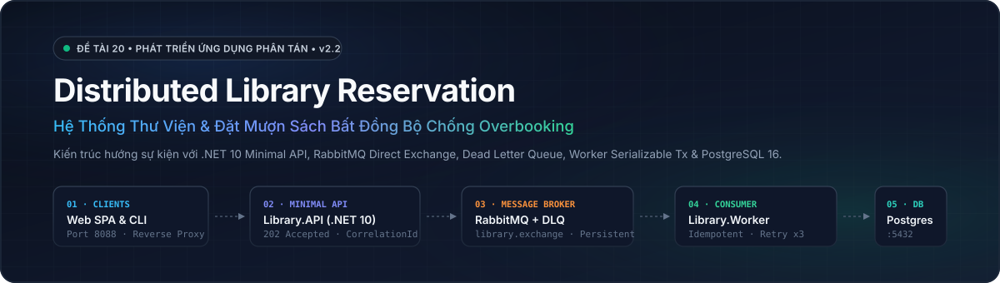
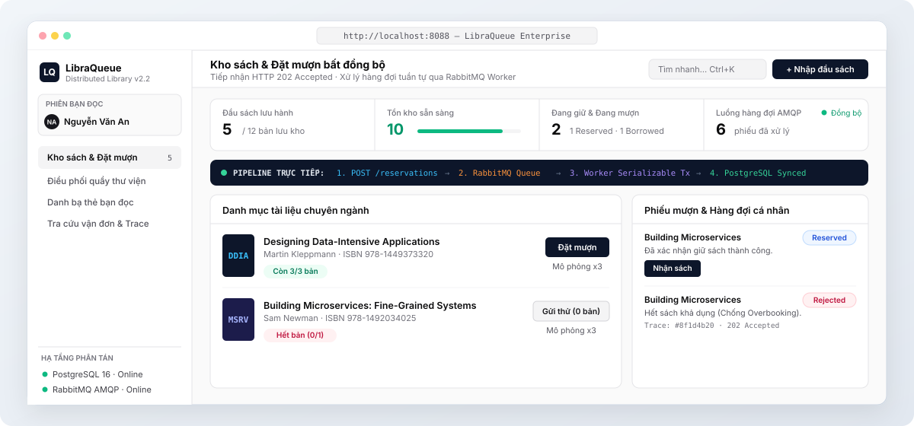
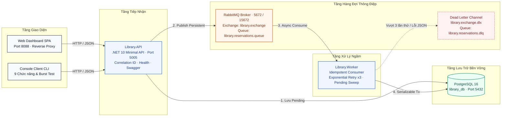
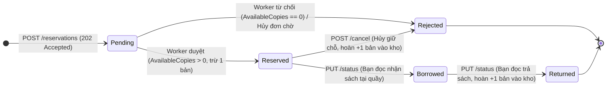
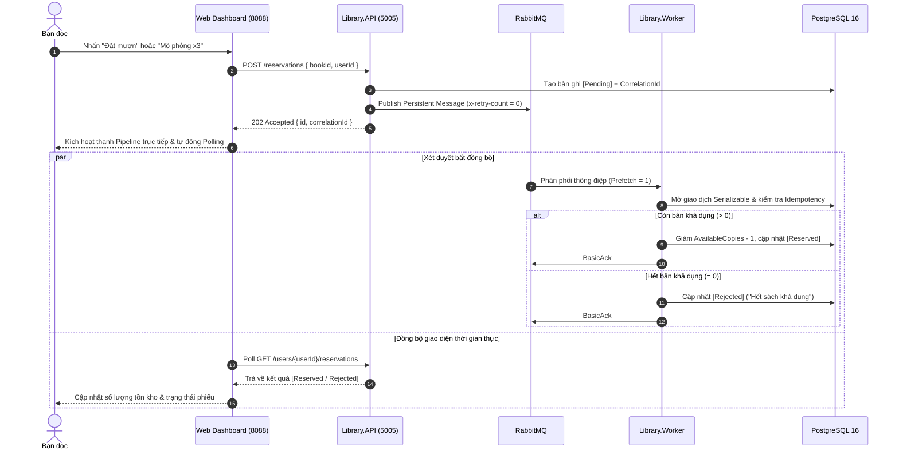

<div align="center">
  

  <br/>
  <br/>

  <p>
    <a href="https://dotnet.microsoft.com/"></a>
    <a href="https://learn.microsoft.com/dotnet/csharp/"></a>
    <a href="https://www.rabbitmq.com/"></a>
    <a href="https://www.postgresql.org/"></a>
    <a href="https://www.docker.com/"></a>
  </p>

  <p>
    <b><a href="#tổng-quan-giao-diện--năng-lực-cốt-lõi">Giao diện</a></b> &nbsp;•&nbsp;
    <b><a href="#kiến-trúc-phân-tán--quy-hoạch-dịch-vụ">Kiến trúc</a></b> &nbsp;•&nbsp;
    <b><a href="#máy-trạng-thái--tuần-tự-xử-lý">Luồng xử lý</a></b> &nbsp;•&nbsp;
    <b><a href="#triển-khai--vận-hành">Khởi chạy</a></b> &nbsp;•&nbsp;
    <b><a href="#tài-liệu-restful-api">API Reference</a></b> &nbsp;•&nbsp;
    <b><a href="#kiểm-thử--kịch-bản-bảo-vệ">Kiểm thử & Demo</a></b>
  </p>
</div>

---

> [!IMPORTANT]
> **Học phần:** Phát triển ứng dụng phân tán — **Đề tài số 20: Hệ thống thư viện và đặt mượn sách phân tán**  
> Giải quyết triệt để hiện tượng **Overbooking** và **nghẽn khóa dòng cơ sở dữ liệu** khi lưu lượng bạn đọc đặt sách tăng đột biến thông qua hàng đợi bất đồng bộ **RabbitMQ**, giao dịch cô lập **`Serializable`**, cơ chế **Retry + Dead Letter Queue** và tự động phục hồi đơn **`Pending`**.

---

## Tổng Quan Giao Diện & Năng Lực Cốt Lõi

<div align="center">
  
  <br/>
  <sub>Giao diện Web Dashboard (Port <code>8088</code>) hỗ trợ Chế độ Sáng/Tối, Command Palette (<code>Ctrl+K</code>), theo dõi Pipeline trực tiếp và mô phỏng chống Overbooking 1-click.</sub>
</div>

<br/>

<table>
  <tr>
    <td width="50%" valign="top">
      <h3>Tiếp Nhận Tức Thì (Non-Blocking 202)</h3>
      <p>Tách biệt hoàn toàn luồng tiếp nhận HTTP tại <code>Library.API</code> khỏi luồng kiểm kê kho tại <code>Library.Worker</code>. Người dùng nhận phản hồi <code>202 Accepted</code> kèm mã truy vết ngay lập tức mà không bị treo bởi khóa cơ sở dữ liệu.</p>
    </td>
    <td width="50%" valign="top">
      <h3>Chống Overbooking Tuyệt Đối</h3>
      <p>Worker tiêu thụ thông điệp tuần tự với <code>Prefetch = 1</code> kết hợp giao dịch cơ sở dữ liệu <code>IsolationLevel.Serializable</code> và kiểm tra <b>Idempotency</b>, đảm bảo tồn kho không bao giờ âm kể cả khi mở rộng nhiều bản sao Worker.</p>
    </td>
  </tr>
  <tr>
    <td width="50%" valign="top">
      <h3>Chịu Lỗi Đa Tầng (Retry + DLQ + Sweep)</h3>
      <p>Tự động thử lại tối đa <b>3 lần</b> theo cấp số nhân (<code>1s → 2s → 4s</code> qua <code>x-retry-count</code>) trước khi cô lập gói tin lỗi vào <code>library.reservations.dlq</code>; đồng thời định kỳ quét phục hồi các bản ghi <code>Pending</code> tồn đọng.</p>
    </td>
    <td width="50%" valign="top">
      <h3>Truy Vết Xuyên Suốt &amp; Health Telemetry</h3>
      <p>Định danh <code>X-Correlation-ID</code> xuyên suốt từ trình duyệt → Reverse Proxy → API → PostgreSQL → RabbitMQ → Worker Logs, đi kèm kiểm tra kết nối trực tiếp tới PostgreSQL và RabbitMQ tại <code>GET /health</code>.</p>
    </td>
  </tr>
</table>

---

## Kiến Trúc Phân Tán & Quy Hoạch Dịch Vụ



### Danh mục 6 Container trong `docker-compose.yml`

| Dịch vụ | Container Name | Cổng Host | Cổng Nội Bộ | Vai trò & Địa chỉ truy cập |
| :--- | :--- | :---: | :---: | :--- |
| **Web Dashboard** | `library_web_client` | `8088` | `8080` | Giao diện 4 phân hệ & Internal Reverse Proxy (`http://localhost:8088`) |
| **Console Client CLI** | `library_console_client` | Interactive CLI | — | Ứng dụng dòng lệnh 9 chức năng (`docker compose --profile cli run --rm console-client`) |
| **Library API** | `library_api` | `5005` | `5000` | Minimal API, Swagger (`http://localhost:5005/swagger`), Health (`http://localhost:5005/health`) |
| **Reservation Worker** | `library_reservation_worker` | Background | — | Consumer ngầm xử lý hàng đợi AMQP, Retry x3, DLQ & phục hồi đơn `Pending` |
| **RabbitMQ Broker** | `library_rabbitmq` | `5672` | `5672` | Điều phối hàng đợi AMQP 0-9-1 (`library.exchange` & `library.reservations.dlq`) |
| **RabbitMQ Management** | `library_rabbitmq` | `15672` | `15672` | Quản trị trực quan Exchange/Queue (`http://localhost:15672` — `guest` / `guest`) |
| **PostgreSQL 16** | `library_postgres` | `5432` | `5432` | Cơ sở dữ liệu quan hệ `library_db` (`postgres` / `postgrespassword`) |

---

## Máy Trạng Thái & Tuần Tự Xử Lý

### 1. Vòng đời trạng thái phiếu đặt mượn (`ReservationStatus`)



### 2. Sơ đồ tuần tự đặt mượn bất đồng bộ



---

## Cấu Trúc Mã Nguồn

```text
distributed-library-reservation-v2/
├── docs/assets/                     # Tài nguyên đồ họa SVG kiến trúc & giao diện
├── src/
│   ├── Library.Domain/              # Thực thể Book, User, Reservation & Message Contract
│   ├── Library.Infrastructure/      # LibraryDbContext, ReservationService, RabbitMqPublisher
│   ├── Library.API/                 # .NET 10 Minimal API, Middleware X-Correlation-ID, Swagger
│   ├── Library.Worker/              # BackgroundService Consumer, Retry + DLQ & Pending Sweep
│   ├── Library.WebClient/           # Giao diện Web Enterprise (Light/Dark, Ctrl+K) & Proxy
│   └── Library.ConsoleClient/       # Ứng dụng dòng lệnh 9 chức năng & Burst Concurrency Test
├── tests/
│   └── Library.Tests/               # 8 bài kiểm thử tự động xUnit gọi trực tiếp ReservationService
├── docker-compose.yml               # Định nghĩa toàn bộ 6 dịch vụ & mạng nội bộ library_network
├── start-windows.bat                # Kịch bản khởi chạy tự động 1-click trên Windows
├── stop-windows.bat                 # Kịch bản dừng và giải phóng tài nguyên Docker
├── run-console-windows.bat          # Mở nhanh Console Client (tự fallback sang Docker nếu thiếu SDK)
├── 20-he-thong-thu-vien-dat-muon-sach.md
├── HUONG-DAN-CHUNG.md
└── BAO-CAO-BAI-TAP-LON.md           # Quyển báo cáo bài tập lớn hoàn chỉnh
```

---

## Triển Khai & Vận Hành

### Phương án 1: Khởi chạy trọn gói bằng Docker Compose (Khuyến nghị)

```bash
git clone https://github.com/azmedia2006/distributed-library-reservation-v2.git
cd distributed-library-reservation-v2
docker compose up -d --build
```

> [!TIP]
> **Trên Windows:** Nhấp đúp trực tiếp vào **`start-windows.bat`** để tự động kiểm tra Docker Desktop, dựng hệ thống và mở thẳng trình duyệt tới `http://localhost:8088`. Chạy **`run-console-windows.bat`** nếu muốn trải nghiệm thêm giao diện dòng lệnh, và **`stop-windows.bat`** khi kết thúc.

| Cổng truy cập nhanh sau khi khởi động | Đường dẫn | Thông tin đăng nhập |
| :--- | :--- | :--- |
| **Giao diện Web Dashboard chính** | [http://localhost:8088](http://localhost:8088) | Không yêu cầu (chuyển đổi thẻ bạn đọc trực tiếp) |
| **Tài liệu tương tác Swagger UI** | [http://localhost:5005/swagger](http://localhost:5005/swagger) | Công khai trong môi trường chạy thử |
| **Kiểm tra tình trạng hạ tầng (Health)** | [http://localhost:5005/health](http://localhost:5005/health) | JSON trạng thái `PostgreSQL` + `RabbitMQ` |
| **Bảng điều khiển RabbitMQ** | [http://localhost:15672](http://localhost:15672) | Tài khoản: `guest` · Mật khẩu: `guest` |

<details>
<summary><b>Phương án 2: Chạy trực tiếp từng dịch vụ bằng .NET 10 SDK (Development Mode)</b></summary>

<br/>

1. Khởi chạy PostgreSQL 16 và RabbitMQ bằng Docker:
   ```bash
   docker compose up -d postgres-db rabbitmq
   ```
2. Chạy độc lập các project trên từng cửa sổ Terminal (cổng `5005` và `8088` đã cấu hình đồng nhất):
   ```bash
   dotnet run --project src/Library.API
   dotnet run --project src/Library.Worker
   dotnet run --project src/Library.WebClient
   dotnet run --project src/Library.ConsoleClient
   ```
</details>

---

## Tài Liệu RESTful API

### 1. Phân hệ Danh mục & Kho sách (`Books`)

| Phương thức | Endpoint | Mô tả chi tiết | Phản hồi |
| :---: | :--- | :--- | :---: |
| `GET` | `/books` | Tra cứu danh sách sách, hỗ trợ `?search=...` và `?availableOnly=true` | `200 OK` |
| `GET` | `/books/{id}` | Chi tiết sách, số bản khả dụng và thống kê đơn đang `Pending`/`Reserved`/`Borrowed` | `200 OK`, `404` |
| `POST` | `/books` | Nhập thêm đầu sách mới vào thư viện | `201 Created` |
| `PUT` | `/books/{id}` | Cập nhật thông tin đầu sách và điều chỉnh tổng số bản lưu kho (`TotalCopies`) | `200 OK`, `400` |

### 2. Phân hệ Đặt mượn Bất đồng bộ (`Reservations`)

| Phương thức | Endpoint | Mô tả chi tiết | Phản hồi |
| :---: | :--- | :--- | :---: |
| `POST` | `/reservations` | Tạo đơn `Pending`, gắn `CorrelationId` và đẩy thông điệp vào RabbitMQ | `202 Accepted` |
| `GET` | `/reservations` | Tra cứu toàn bộ phiếu mượn hệ thống (`?status=...&search=...`) | `200 OK` |
| `GET` | `/reservations/{id}` | Tra cứu trạng thái xử lý, 4 mốc thời gian và `CorrelationId` của đơn | `200 OK`, `404` |
| `PUT` | `/reservations/{id}/status` | Chuyển trạng thái nhận sách (`Borrowed`) hoặc trả sách (`Returned`, cộng `+1` bản) | `200 OK`, `400` |
| `POST` | `/reservations/{id}/cancel` | Hủy phiếu đang `Pending` hoặc `Reserved` (hoàn lại bản sách nếu đã giữ chỗ) | `200 OK`, `400` |

### 3. Phân hệ Bạn đọc & Giám sát Hệ thống (`Users & Telemetry`)

| Phương thức | Endpoint | Mô tả chi tiết | Phản hồi |
| :---: | :--- | :--- | :---: |
| `GET` | `/users` | Lấy danh sách toàn bộ thẻ bạn đọc | `200 OK` |
| `POST` | `/users` | Cấp mới thẻ bạn đọc (kiểm tra trùng lặp Email) | `201 Created` |
| `GET` | `/users/{userId}/reservations` | Danh sách sách đang đặt/mượn (`?activeOnly=true`) hoặc lịch sử của bạn đọc | `200 OK`, `404` |
| `GET` | `/stats` | Chỉ số vận hành tổng hợp toàn thư viện cho Dashboard | `200 OK` |
| `GET` | `/health` | Kiểm tra kết nối trực tiếp tới PostgreSQL 16 và RabbitMQ Broker | `200 OK` |

---

## Kiểm Thử & Kịch Bản Bảo Vệ

### Bộ kiểm thử tự động (`xUnit`)

```bash
dotnet test
```

- [x] `ProcessReservation_WhenBookAvailable_ShouldReserveAndDecreaseCopies` — Duyệt giữ sách & trừ kho chính xác.
- [x] `ProcessReservation_WhenBookOutOfStock_ShouldRejectReservation` — Từ chối an toàn khi hết bản khả dụng.
- [x] `ProcessReservation_Idempotency_DuplicateMessageShouldNotDeductTwice` — Chống trừ kho lặp khi nhận tin nhắn trùng.
- [x] `UpdateStatus_FromReservedToBorrowed_ShouldSucceed` — Bàn giao sách hợp lệ tại quầy.
- [x] `UpdateStatus_FromBorrowedToReturned_ShouldRestoreAvailableCopiesUpToTotal` — Thu hồi sách & hoàn trả tồn kho.
- [x] `UpdateStatus_InvalidTransition_PendingToBorrowed_ShouldReturnFailure` — Chặn chuyển trạng thái sai quy trình.
- [x] `CancelReservation_WhenReserved_ShouldRestoreAvailableCopyAndMarkRejected` — Hủy giữ chỗ hoàn trả lại bản sách.
- [x] `ProcessReservation_BurstRequestsForSingleCopy_ShouldApproveExactlyOneAndRejectRest` — Chống Overbooking khi 5 yêu cầu tới cùng lúc cho cuốn sách chỉ còn 1 bản.

### Kịch bản trình diễn nhanh trên Web Dashboard (`http://localhost:8088`)

1. **Mở Command Palette (`Ctrl + K`):** Chuyển nhanh chế độ Sáng/Tối, đổi thẻ bạn đọc hoặc kích hoạt ngay bài test chịu tải đồng thời.
2. **Minh họa chống Overbooking 1-Click:** Tại đầu sách *"Building Microservices"* (chỉ có **1 bản**), nhấn **`Mô phỏng x3`** — quan sát thanh **Live Distributed Pipeline** sáng lần lượt qua 4 chặng xử lý, kết quả **1 đơn `Reserved`** và **2 đơn `Rejected`** (*tồn kho giữ nguyên `0/1`, tuyệt đối không âm*).
3. **Minh họa chịu lỗi khi dừng Worker:** Chạy `docker compose stop reservation-worker`, tiếp tục đặt sách trên Web (đơn nằm an toàn ở `Pending` trong RabbitMQ), sau đó chạy `docker compose start reservation-worker` để thấy Worker tự động tiêu thụ và duyệt toàn bộ hàng đợi tồn đọng.

---

<div align="center">
  <sub>Phát triển cho Đề tài số 20 — Học phần Phát triển ứng dụng phân tán • Kiến trúc .NET 10, RabbitMQ & PostgreSQL 16</sub>
</div>
