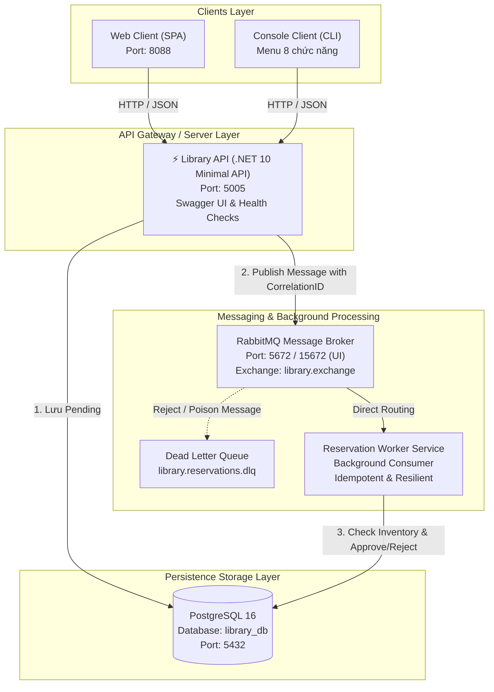
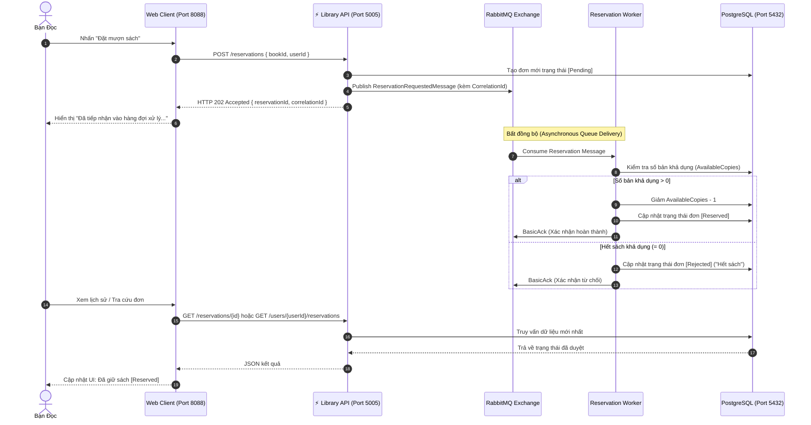

# Hệ Thống Thư Viện & Đặt Mượn Sách Phân Tán
### Distributed Library Reservation System

<p align="center">
  
  
  
  
  
  
</p>

> **Học phần:** Phát triển ứng dụng phân tán  
> **Đề tài số 20:** Hệ thống thư viện và đặt mượn sách phân tán (Xử lý hàng đợi bất đồng bộ với RabbitMQ, chống Overbooking, kiến trúc vi dịch vụ & Docker).

---

## Mục Lục
- [1. Tổng Quan Bài Toán & Giải Pháp](#1-tổng-quan-bài-toán--giải-pháp)
- [2. Sơ Đồ Kiến Trúc Hệ Thống (Architecture Diagram)](#2-sơ-đồ-kiến-trúc-hệ-thống-architecture-diagram)
- [3. Sơ Đồ Luồng Dữ Liệu & Hàng Đợi (Sequence Flow)](#3-sơ-đồ-luồng-dữ-liệu--hàng-đợi-sequence-flow)
- [4. Công Nghệ & Điểm Nhấn Kỹ Thuật Nâng Cao](#4-công-nghệ--điểm-nhấn-kỹ-thuật-nâng-cao)
- [5. Cấu Trúc Mã Nguồn Thư Mục](#5-cấu-trúc-mã-nguồn-thư-mục)
- [6. Hướng Dẫn Cài Đặt & Vận Hành](#6-hướng-dẫn-cài-đặt--vận-hành)
  - [Dành cho người dùng Windows](#hướng-dẫn-dành-cho-windows)
  - [Dành cho người dùng Ubuntu / Linux](#hướng-dẫn-dành-cho-ubuntu--linux)
- [7. Danh Sách RESTful API & Swagger](#7-danh-sách-restful-api--swagger)
- [8. Hướng Dẫn Kiểm Thử Tự Động & Kịch Bản Demo](#8-hướng-dẫn-kiểm-thử-tự-động--kịch-bản-demo)

---

## 1. Tổng Quan Bài Toán & Giải Pháp

Trong các hệ thống quản lý mượn sách truyền thống, các giao dịch kiểm tra số bản còn lại và lưu đơn thường được thực hiện **đồng bộ (synchronous)** trực tiếp vào Database. Khi lưu lượng độc giả truy cập tăng vọt:
- **Race Condition & Overbooking:** Nhiều bạn đọc cùng đặt 1 cuốn sách cuối cùng, dẫn đến tình trạng kho bị âm hoặc quá tải.
- **Database Bottleneck:** Khóa dòng (Row locks) gây nghẽn toàn bộ dịch vụ tra cứu sách.

**Giải pháp phân tán áp dụng trong dự án:**
1. **Tiếp nhận tức thì (Non-blocking):** Client gửi yêu cầu -> API lưu trạng thái sơ bộ `Pending` -> Trả về `202 Accepted` ngay cho người dùng mà không cần chờ khóa dữ liệu.
2. **Xếp hàng tin cậy qua Message Broker:** Đẩy thông điệp vào RabbitMQ (sử dụng Direct Exchange).
3. **Background Worker Service:** Tiêu thụ thông điệp theo thứ tự, kiểm tra số lượng bản khả dụng trong Database:
   - Nếu `AvailableCopies > 0`: Trừ 1 bản, phê duyệt đơn `Reserved`.
   - Nếu `AvailableCopies == 0`: Từ chối đơn `Rejected` kèm thông báo lý do rõ ràng.
4. **Vòng đời mượn - trả:** Hỗ trợ chuyển trạng thái sang `Borrowed` khi đến nhận sách và tự động hoàn lại (+1) số bản khả dụng khi trả sách `Returned`.

---

## 2. Sơ Đồ Kiến Trúc Hệ Thống (Architecture Diagram)



---

## 3. Sơ Đồ Luồng Dữ Liệu & Hàng Đợi (Sequence Flow)



---

## 4. Công Nghệ & Điểm Nhấn Kỹ Thuật Nâng Cao

Hệ thống được thiết kế đáp ứng toàn bộ các yêu cầu cơ bản và các nội dung mở rộng theo quy định:

| Kỹ thuật | Chi tiết áp dụng trong dự án |
| :--- | :--- |
| **.NET 10 & Minimal API** | Tối ưu hóa hiệu năng, giảm overhead, code gọn gàng, tích hợp Swagger UI và CORS. |
| **Message Queue & Direct Exchange** | Mô hình bất đồng bộ với hàng đợi RabbitMQ, tách rời hoàn toàn quá trình tiếp nhận và xử lý mượn sách. |
| **Dead Letter Queue (DLQ)** | Cấu hình DLX `library.dlx.exchange` và queue `library.reservations.dlq` để cách ly và xử lý tin nhắn lỗi. |
| **Correlation ID Tracking** | Gắn mã UUID định danh xuyên suốt từ Client -> API -> RabbitMQ -> Worker -> Logs hệ thống. |
| **Idempotent Consumer** | Worker kiểm tra trạng thái trước khi trừ kho để loại trừ nguy cơ xử lý trùng thông điệp (At-least-once delivery). |
| **Health Check Endpoint** | Cung cấp endpoint `/health` theo dõi tình trạng sống còn của hệ thống. |
| **Internal Reverse Proxy** | Web Client tích hợp sẵn proxy nội bộ giúp loại bỏ 100% lỗi CORS và lỗi lệch cổng khi chạy trên máy chủ/môi trường khác nhau. |
| **Automated Testing** | Bộ kiểm thử tự động với xUnit và EntityFramework InMemory bao phủ đầy đủ các case nghiệp vụ. |

---

## 5. Cấu Trúc Mã Nguồn Thư Mục

```text
distributed-library-reservation
├── 20-he-thong-thu-vien-dat-muon-sach.md  # Yêu cầu chi tiết đề tài 20
├── HUONG-DAN-CHUNG.md                     # Hướng dẫn chung của học phần
├── BAO-CAO-BAI-TAP-LON.md                 # Quyển báo cáo bài tập lớn hoàn chỉnh
├── LibraryDistributedSystem.slnx          # Solution file .NET 10
├── docker-compose.yml                     # File khởi chạy toàn bộ 5 dịch vụ
├── README.md                              # Hướng dẫn chi tiết
├── src/
│   ├── Library.Domain/                    # Domain Entities (Book, User, Reservation) & Messages
│   ├── Library.Infrastructure/            # EF Core DbContext, RabbitMQ Publisher & Constants
│   ├── Library.API/                       # Minimal API, Swagger UI, Health Check
│   ├── Library.Worker/                    # Background Service lắng nghe & xử lý Message từ RabbitMQ
│   ├── Library.WebClient/                 # Giao diện Web Client & Reverse Proxy API
│   └── Library.ConsoleClient/             # Giao diện Console Client (CLI App)
└── tests/
    └── Library.Tests/                     # Bộ kiểm thử Unit Test & Nghiệp vụ (xUnit)
```

---

## 6. Hướng Dẫn Cài Đặt & Vận Hành

---

### Hướng Dẫn Dành Cho Windows

### Hướng Dẫn Dành Cho Windows

#### Cách 1: Khởi Chạy Nhanh 1-Click Bằng File `.bat` (Siêu tiện lợi & Nhanh nhất)
1. Đảm bảo **Docker Desktop for Windows** đang được mở và chạy (biểu tượng cá voi màu xanh).
2. Click đúp chuột vào file:
   - **`start-windows.bat`**: Script sẽ tự động kiểm tra Docker, build toàn bộ 5 dịch vụ, khởi chạy hệ thống ngầm và **tự động mở trình duyệt Web Client** (`http://localhost:8088`).
   - **`stop-windows.bat`**: Dừng nhanh toàn bộ hệ thống và giải phóng tài nguyên RAM/CPU.
   - **`run-console-windows.bat`**: Mở nhanh giao diện Console CLI tương tác bằng dòng lệnh.

---

#### Cách 2: Khởi chạy bằng lệnh Docker Compose (PowerShell / Command Prompt)
1. **Cài đặt trước:** Đảm bảo máy tính đã cài đặt và đang chạy **Docker Desktop for Windows**.
2. **Khởi chạy:**
   - Mở **PowerShell** hoặc **Command Prompt (CMD)**, di chuyển vào thư mục dự án:
     ```powershell
     cd "đường_dẫn_tới_thư_mục\ứng dụng phân tán"
     ```
   - Khởi chạy toàn bộ hệ thống bằng 1 câu lệnh duy nhất:
     ```powershell
     docker compose up -d --build
     ```
   - Kiểm tra các container đang hoạt động:
     ```powershell
     docker compose ps
     ```
3. **Mở trình duyệt truy cập:**
   - **Giao diện Web Client:** [http://localhost:8088](http://localhost:8088)
   - **Swagger API Docs:** [http://localhost:5005/swagger](http://localhost:5005/swagger)
   - **RabbitMQ Dashboard:** [http://localhost:15672](http://localhost:15672) *(Tài khoản: `guest` / `guest`)*
4. **Tắt hệ thống:**
   ```powershell
   docker compose down
   ```

#### Cách 2: Chạy trực tiếp từ mã nguồn (.NET SDK trên Windows)
1. Cài đặt **.NET 10 SDK** từ trang chủ Microsoft.
2. Dùng Docker để bật database PostgreSQL và RabbitMQ:
   ```powershell
   docker compose up -d postgres-db rabbitmq
   ```
3. Mở 3 cửa sổ PowerShell / Terminal riêng biệt để chạy từng service:
   - **Terminal 1 (Library API):**
     ```powershell
     dotnet run --project src\Library.API
     ```
   - **Terminal 2 (Reservation Worker):**
     ```powershell
     dotnet run --project src\Library.Worker
     ```
   - **Terminal 3 (Web Client hoặc Console Client):**
     ```powershell
     # Chạy Web Client:
     dotnet run --project src\Library.WebClient
     
     # HOẶC Chạy Console Client tương tác dòng lệnh:
     dotnet run --project src\Library.ConsoleClient
     ```

---

### Hướng Dẫn Dành Cho Ubuntu / Linux

#### Cách 1: Chạy tự động trọn gói bằng Docker Compose (Khuyến nghị số 1)
1. **Kiểm tra Docker Compose:**
   ```bash
   docker compose version
   ```
2. **Khởi chạy hệ thống:**
   ```bash
   # Di chuyển vào thư mục dự án
   cd "/đường_dẫn_tới_thư_mục/ứng dụng phân tán"

   # Build và khởi chạy background
   docker compose up -d --build
   ```
3. **Kiểm tra trạng thái & theo dõi Logs:**
   ```bash
   # Xem các container đang chạy
   docker compose ps

   # Xem logs xử lý của Worker & API theo thời gian thực
   docker compose logs -f library-api reservation-worker
   ```
4. **Truy cập dịch vụ:**
   - **Giao diện Web:** [http://localhost:8088](http://localhost:8088)
   - **Swagger UI:** [http://localhost:5005/swagger](http://localhost:5005/swagger)
   - **RabbitMQ Manager:** [http://localhost:15672](http://localhost:15672)
5. **Dừng hệ thống:**
   ```bash
   docker compose down
   ```

#### Cách 2: Chạy trực tiếp từ mã nguồn (.NET SDK trên Ubuntu)
1. Cài đặt **.NET 10 SDK** trên Ubuntu:
   ```bash
   sudo apt-get update && sudo apt-get install -y dotnet-sdk-10.0
   ```
2. Khởi chạy 2 service hạ tầng PostgreSQL và RabbitMQ qua Docker:
   ```bash
   docker compose up -d postgres-db rabbitmq
   ```
3. Mở các tab terminal riêng biệt và chạy từng dịch vụ:
   - **Cửa sổ 1 (API):** `dotnet run --project src/Library.API`
   - **Cửa sổ 2 (Worker):** `dotnet run --project src/Library.Worker`
   - **Cửa sổ 3 (Web Client):** `dotnet run --project src/Library.WebClient`
   - **Cửa sổ 4 (Console CLI):** `dotnet run --project src/Library.ConsoleClient`

---

## 7. Danh Sách RESTful API & Swagger

| Phương thức | Endpoint | Mô tả | Mã phản hồi |
| :---: | :--- | :--- | :---: |
| `GET` | `/books` | Lấy danh sách toàn bộ sách trong thư viện | `200 OK` |
| `GET` | `/books/{id}` | Lấy thông tin chi tiết và số bản khả dụng của sách | `200 OK`, `404 Not Found` |
| `POST` | `/reservations` | Tiếp nhận yêu cầu đặt mượn sách, đẩy vào RabbitMQ | `202 Accepted` |
| `GET` | `/reservations/{id}` | Tra cứu trạng thái yêu cầu đặt mượn theo ID | `200 OK`, `404 Not Found` |
| `GET` | `/users/{userId}/reservations` | Tra cứu lịch sử đặt/mượn sách của một bạn đọc | `200 OK`, `404 Not Found` |
| `PUT` | `/reservations/{id}/status` | Cập nhật nhận sách (`Borrowed`) hoặc trả sách (`Returned`) | `200 OK`, `400 Bad Request` |
| `GET` | `/users` | Lấy danh sách bạn đọc mẫu để thử nghiệm | `200 OK` |
| `GET` | `/health` | Kiểm tra tình trạng hoạt động của dịch vụ (Health Check) | `200 OK` |

---

## 8. Hướng Dẫn Kiểm Thử Tự Động & Kịch Bản Demo

### 8.1. Chạy bộ kiểm thử tự động (Unit Test)
Dự án được viết sẵn 4 test case chuyên sâu kiểm tra toàn diện nghiệp vụ đặt mượn:
```bash
dotnet test
```
**Kết quả kiểm thử:**
- `ProcessReservation_WhenBookAvailable_ShouldReserveAndDecreaseCopies`
- `ProcessReservation_WhenBookOutOfStock_ShouldRejectReservation`
- `UpdateStatus_ToReturned_ShouldIncreaseAvailableCopies`
- `ProcessReservation_Idempotency_ShouldNotDeductTwice`

### 8.2. Kịch bản minh họa khi thuyết trình (Demo Flow)
1. **Bước 1:** Mở Web Client tại [http://localhost:8088](http://localhost:8088) (hoặc mở Console Client).
2. **Bước 2:** Chọn bạn đọc (ví dụ: *Nguyễn Văn An*).
3. **Bước 3:** Bấm nút **Đặt mượn** cho một cuốn sách còn bản khả dụng.
   - Quan sát log của Worker: Worker nhận thông điệp, kiểm tra số sách > 0 -> duyệt đơn sang `Reserved` và trừ số bản còn lại đi 1.
4. **Bước 4:** Bạn đọc đến nhận sách -> Bấm **Nhận sách (Borrowed)** -> Trạng thái chuyển thành `Borrowed`.
5. **Bước 5:** Bạn đọc mang sách trả lại -> Bấm **Trả sách (Returned)** -> Trạng thái chuyển thành `Returned`, số bản khả dụng tự động tăng lại 1.
6. **Bước 6 (Chống Overbooking):** Tiếp tục đặt sách đến khi số bản = 0. Đặt thêm 1 yêu cầu mới -> Worker tự động từ chối với thông báo `Rejected` ("Hết sách khả dụng").

---

<p align="center">
  <b>Học phần Phát triển ứng dụng phân tán • Đề tài 20</b><br/>
  <i>Được xây dựng với C#, .NET 10, RabbitMQ, Worker Service, PostgreSQL & Docker Compose.</i>
</p>
