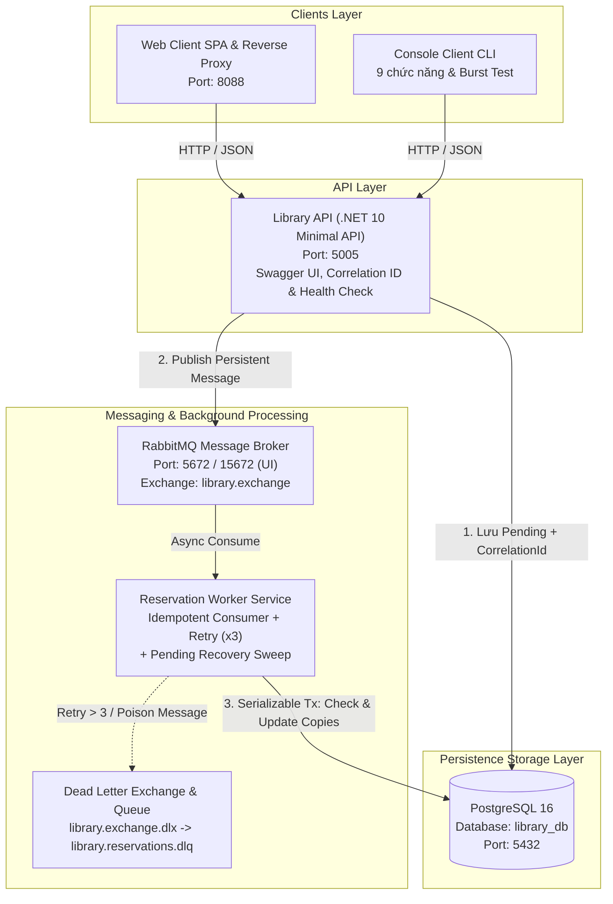
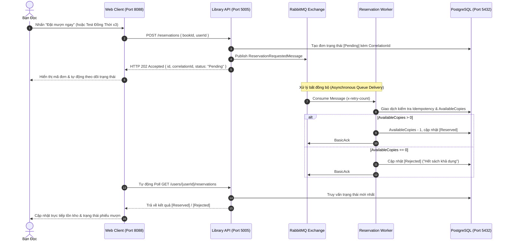

# Hệ Thống Thư Viện & Đặt Mượn Sách Phân Tán
### Distributed Library Reservation System

<p align="center">
  
  
  
  
  
  
</p>

> **Học phần:** Phát triển ứng dụng phân tán  
> **Đề tài số 20:** Hệ thống thư viện và đặt mượn sách phân tán (Xử lý hàng đợi bất đồng bộ với RabbitMQ, Retry + Dead Letter Queue, tự phục hồi đơn `Pending`, chống Overbooking, kiến trúc phân tách dịch vụ & Docker Compose).

---

## Mục Lục
- [1. Tổng Quan Bài Toán & Giải Pháp](#1-tổng-quan-bài-toán--giải-pháp)
- [2. Sơ Đồ Kiến Trúc Hệ Thống (Architecture Diagram)](#2-sơ-đồ-kiến-trúc-hệ-thống-architecture-diagram)
- [3. Sơ Đồ Luồng Dữ Liệu & Hàng Đợi (Sequence Flow)](#3-sơ-đồ-luồng-dữ-liệu--hàng-đợi-sequence-flow)
- [4. Công Nghệ & Điểm Nhấn Kỹ Thuật Nâng Cao](#4-công-nghệ--điểm-nhấn-kỹ-thuật-nâng-cao)
- [5. Cấu Trúc Mã Nguồn Thư Mục](#5-cấu-trúc-mã-nguồn-thư-mục)
- [6. Hướng Dẫn Cài Đặt & Vận Hành](#6-hướng-dẫn-cài-đặt--vận-hành)
  - [Dành cho người dùng Windows](#hướng-dẫn-dành-cho-windows)
  - [Dành cho người dùng Ubuntu / Linux](#hướng-dẫn-dành-cho-ubuntu--linux)
- [7. Danh Sách RESTful API & Swagger](#7-danh-sách-restful-api--swagger)
- [8. Hướng Dẫn Kiểm Thử Tự Động & Kịch Bản Demo](#8-hướng-dẫn-kiểm-thử-tự-động--kịch-bản-demo)

---

## 1. Tổng Quan Bài Toán & Giải Pháp

Trong các hệ thống quản lý mượn sách truyền thống, các giao dịch kiểm tra số bản còn lại và lưu đơn thường được thực hiện **đồng bộ (synchronous)** trực tiếp vào Database. Khi lưu lượng độc giả truy cập tăng vọt:
- **Race Condition & Overbooking:** Nhiều bạn đọc cùng đặt cuốn sách cuối cùng dẫn đến kho bị âm hoặc dữ liệu không nhất quán.
- **Database Bottleneck:** Khóa dòng (row locks) gây nghẽn toàn bộ dịch vụ tra cứu sách.

**Giải pháp phân tán áp dụng trong dự án:**
1. **Tiếp nhận tức thì (Non-blocking):** Client gửi yêu cầu -> API lưu trạng thái sơ bộ `Pending` kèm mã truy vết `CorrelationId` -> Trả về `202 Accepted` ngay lập tức.
2. **Xếp hàng tin cậy qua Message Broker:** Đẩy thông điệp bền vững (`Persistent`) vào RabbitMQ thông qua Direct Exchange `library.exchange`.
3. **Background Worker Service & Chống Overbooking:** Tiêu thụ thông điệp theo thứ tự trong giao dịch cô lập (`Serializable`), kiểm tra số bản khả dụng (`AvailableCopies`) trong PostgreSQL:
   - Nếu `AvailableCopies > 0`: Trừ 1 bản, phê duyệt đơn sang `Reserved`.
   - Nếu `AvailableCopies == 0`: Từ chối đơn sang `Rejected` kèm thông báo lý do rõ ràng.
4. **Chịu lỗi & Tự phục hồi (Resilience):**
   - **Retry lùi mũ + Dead Letter Queue:** Thử lại tối đa 3 lần (`x-retry-count`) trước khi cô lập tin nhắn lỗi vào `library.reservations.dlq`.
   - **Pending Recovery Sweep:** Ngay cả khi RabbitMQ tạm thời gián đoạn lúc tiếp nhận đơn, Worker định kỳ quét và xử lý bù các đơn `Pending` tồn đọng, đảm bảo không bao giờ thất lạc yêu cầu.
5. **Vòng đời mượn - trả - hủy khép kín:** Hỗ trợ nhận sách (`Borrowed`), trả sách (`Returned` — tự động hoàn `+1` bản khả dụng) và hủy đơn đặt trước (`Cancel` — tự động giải phóng bản đang giữ chỗ).

---

## 2. Sơ Đồ Kiến Trúc Hệ Thống (Architecture Diagram)



---

## 3. Sơ Đồ Luồng Dữ Liệu & Hàng Đợi (Sequence Flow)



---

## 4. Công Nghệ & Điểm Nhấn Kỹ Thuật Nâng Cao

Hệ thống đáp ứng đầy đủ các yêu cầu bắt buộc của **Đề tài 20** và toàn bộ các yêu cầu mở rộng trong `HUONG-DAN-CHUNG.md`:

| Kỹ thuật | Chi tiết áp dụng trong dự án |
| :--- | :--- |
| **.NET 10 & Minimal API** | Tách biệt rõ `Domain`, `Infrastructure` (`ReservationService`), `API`, `Worker`, `WebClient` và `ConsoleClient`. |
| **RabbitMQ Thread-Safe Publisher** | Đồng bộ khóa kênh AMQP đa luồng, hỗ trợ bắn hàng loạt request song song (Burst Concurrency) an toàn tuyệt đối. |
| **Retry + Dead Letter Queue (DLQ)** | Thử lại tối đa 3 lần với độ trễ tăng theo cấp số nhân (`1s`, `2s`, `4s`) qua header `x-retry-count`; vượt ngưỡng tự động chuyển sang `library.reservations.dlq`. |
| **Pending Outbox Recovery** | Worker tự động quét và xử lý bù các bản ghi `Pending` quá hạn nếu RabbitMQ tạm thời gián đoạn lúc tiếp nhận. |
| **Correlation ID Middleware** | Gắn và phản hồi header `X-Correlation-ID` xuyên suốt từ HTTP Request -> Database -> RabbitMQ -> Worker Logs -> Giao diện người dùng. |
| **Idempotent & Serializable Transaction** | Kiểm tra trạng thái đơn trước khi trừ kho kết hợp giao dịch `Serializable` ngăn chặn triệt để xử lý trùng và Race Condition. |
| **Live Component Health Check** | Endpoint `/health` kiểm tra kết nối thực tế tới cả **PostgreSQL** và **RabbitMQ**, hiển thị đèn trạng thái trực tiếp trên thanh điều hướng Web. |
| **Internal Reverse Proxy & 2-Tab Portal** | Web Client tích hợp proxy nội bộ loại bỏ lỗi CORS, cung cấp đồng thời **Cổng Bạn Đọc** và **Cổng Quản Trị Thủ Thư**. |
| **Real Service Automated Testing** | 8 kịch bản Unit Test (`xUnit` + EF Core InMemory) kiểm thử trực tiếp `ReservationService`. |

---

## 5. Cấu Trúc Mã Nguồn Thư Mục

```text
distributed-library-reservation-v2
├── 20-he-thong-thu-vien-dat-muon-sach.md  # Đề bài chi tiết Đề tài 20
├── HUONG-DAN-CHUNG.md                     # Yêu cầu kỹ thuật chung của học phần
├── BAO-CAO-BAI-TAP-LON.md                 # Quyển báo cáo bài tập lớn hoàn chỉnh
├── LibraryDistributedSystem.slnx          # Solution file .NET 10
├── docker-compose.yml                     # Khởi chạy trọn gói 5 container qua Docker network
├── start-windows.bat / stop-windows.bat   # Script 1-click khởi chạy / dừng nhanh trên Windows
├── run-console-windows.bat                # Script mở nhanh Console Client trên Windows
├── src/
│   ├── Library.Domain/                    # Thực thể Book, User, Reservation & Message Contract
│   ├── Library.Infrastructure/            # LibraryDbContext, ReservationService, RabbitMqPublisher
│   ├── Library.API/                       # Minimal API, Correlation ID Middleware, Swagger, Health Check
│   ├── Library.Worker/                    # Background Consumer, Retry + DLQ & Pending Recovery
│   ├── Library.WebClient/                 # Giao diện Web SPA 2 phân hệ & Internal Reverse Proxy
│   └── Library.ConsoleClient/             # Ứng dụng CLI 9 chức năng kèm công cụ Burst Test
└── tests/
    └── Library.Tests/                     # 8 Unit Tests kiểm thử nghiệp vụ ReservationService
```

---

## 6. Hướng Dẫn Cài Đặt & Vận Hành

### Hướng Dẫn Dành Cho Windows

#### Cách 1: Khởi chạy nhanh 1-Click bằng file `.bat` (Khuyến nghị)
1. Mở và đợi **Docker Desktop for Windows** chuyển sang trạng thái sẵn sàng (Running).
2. Nhấp đúp vào các tệp kịch bản tại thư mục gốc:
   - **`start-windows.bat`**: Tự động kiểm tra Docker, build toàn bộ 5 dịch vụ, chạy ngầm và mở trình duyệt tới Web Client (`http://localhost:8088`).
   - **`stop-windows.bat`**: Dừng toàn bộ container và giải phóng tài nguyên.
   - **`run-console-windows.bat`**: Khởi chạy ứng dụng dòng lệnh Console Client.

#### Cách 2: Khởi chạy bằng lệnh Docker Compose
```powershell
git clone https://github.com/azmedia2006/distributed-library-reservation-v2.git
cd distributed-library-reservation-v2
docker compose up -d --build
docker compose ps
```
- **Web Client (Bạn đọc & Quản trị):** http://localhost:8088
- **Library API Swagger UI:** http://localhost:5005/swagger
- **Health Check JSON:** http://localhost:5005/health
- **RabbitMQ Management UI:** http://localhost:15672 *(Tài khoản: `guest` / `guest`)*

Khi cần dừng hệ thống:
```powershell
docker compose down
```

#### Cách 3: Chạy trực tiếp từ mã nguồn với .NET 10 SDK
1. Khởi chạy hạ tầng PostgreSQL và RabbitMQ bằng Docker:
   ```powershell
   docker compose up -d postgres-db rabbitmq
   ```
2. Mở các cửa sổ Terminal riêng biệt để chạy từng tiến trình (cấu hình cổng `5005` và `8088` đã được đồng bộ sẵn):
   ```powershell
   # Terminal 1 - Library API (Port 5005)
   dotnet run --project src\Library.API

   # Terminal 2 - Reservation Worker
   dotnet run --project src\Library.Worker

   # Terminal 3 - Web Client (Port 8088) hoặc Console Client
   dotnet run --project src\Library.WebClient
   # Hoặc:
   dotnet run --project src\Library.ConsoleClient
   ```

---

### Hướng Dẫn Dành Cho Ubuntu / Linux

```bash
git clone https://github.com/azmedia2006/distributed-library-reservation-v2.git
cd distributed-library-reservation-v2

# Build và khởi chạy toàn bộ 5 container
docker compose up -d --build

# Theo dõi log xử lý bất đồng bộ kèm CorrelationId theo thời gian thực
docker compose logs -f library-api reservation-worker
```

---

## 7. Danh Sách RESTful API & Swagger

| Phương thức | Endpoint | Mô tả chức năng | Mã phản hồi |
| :---: | :--- | :--- | :---: |
| `GET` | `/books` | Tra cứu danh sách sách (`?search=...&availableOnly=true`) | `200 OK` |
| `GET` | `/books/{id}` | Chi tiết đầu sách, số bản khả dụng và thống kê đơn đang giữ/mượn | `200 OK`, `404` |
| `POST` | `/books` | Thêm đầu sách mới vào kho thư viện | `201 Created` |
| `PUT` | `/books/{id}` | Cập nhật thông tin sách và điều chỉnh tổng số bản (`TotalCopies`) | `200 OK`, `400` |
| `POST` | `/reservations` | Tiếp nhận yêu cầu đặt mượn (`Pending`), đẩy vào RabbitMQ | `202 Accepted` |
| `GET` | `/reservations` | Danh sách toàn bộ đơn đặt mượn trong hệ thống (`?status=...&search=...`) | `200 OK` |
| `GET` | `/reservations/{id}` | Tra cứu chi tiết trạng thái xử lý và `CorrelationId` của đơn | `200 OK`, `404` |
| `GET` | `/users/{userId}/reservations` | Tra cứu sách đang đặt/mượn (`?activeOnly=true`) hoặc lịch sử bạn đọc | `200 OK`, `404` |
| `PUT` | `/reservations/{id}/status` | Cập nhật nhận sách (`Borrowed`) hoặc trả sách (`Returned`, hoàn `+1` bản) | `200 OK`, `400` |
| `POST` | `/reservations/{id}/cancel` | Hủy đơn đang `Pending` hoặc `Reserved` (hoàn lại bản sách nếu đã giữ) | `200 OK`, `400` |
| `GET` | `/users` | Danh sách bạn đọc trong hệ thống | `200 OK` |
| `POST` | `/users` | Đăng ký thẻ bạn đọc mới | `201 Created` |
| `GET` | `/stats` | Số liệu thống kê tổng hợp cho Dashboard | `200 OK` |
| `GET` | `/health` | Kiểm tra kết nối thực tế tới PostgreSQL và RabbitMQ | `200 OK` |

---

## 8. Hướng Dẫn Kiểm Thử Tự Động & Kịch Bản Demo

### 8.1. Chạy bộ kiểm thử tự động (Unit Tests)
```bash
dotnet test
```
Bộ 8 kịch bản kiểm thử trong `tests/Library.Tests/ReservationProcessingTests.cs` bao phủ:
1. `ProcessReservation_WhenBookAvailable_ShouldReserveAndDecreaseCopies`
2. `ProcessReservation_WhenBookOutOfStock_ShouldRejectReservation`
3. `ProcessReservation_Idempotency_DuplicateMessageShouldNotDeductTwice`
4. `UpdateStatus_FromReservedToBorrowed_ShouldSucceed`
5. `UpdateStatus_FromBorrowedToReturned_ShouldRestoreAvailableCopiesUpToTotal`
6. `UpdateStatus_InvalidTransition_PendingToBorrowed_ShouldReturnFailure`
7. `CancelReservation_WhenReserved_ShouldRestoreAvailableCopyAndMarkRejected`
8. `ProcessReservation_BurstRequestsForSingleCopy_ShouldApproveExactlyOneAndRejectRest`

### 8.2. Kịch bản minh họa trực tiếp khi bảo vệ (Live Demo Flow)
1. **Kiểm tra trạng thái hệ thống:** Mở http://localhost:8088 — quan sát 2 đèn `PostgreSQL: Online` và `RabbitMQ: Online` cùng bảng thống kê KPI trên đầu trang.
2. **Tra cứu & Xem chi tiết sách:** Tìm cuốn *"Building Microservices"* (có sẵn **1 bản khả dụng**), nhấn **Chi tiết & Tồn kho** để xem dữ liệu từ `GET /books/{id}`.
3. **Demo chống Overbooking 1-Click:** Nhấn nút **`Test Đồng Thời (x3)`** ngay trên cuốn sách 1 bản đó:
   - Web Client bắn song song 3 request `POST /reservations`, cả 3 đều nhận `202 Accepted` tức thì.
   - `Reservation Worker` lần lượt rút từng thông điệp từ RabbitMQ: **duyệt đúng 1 đơn sang `Reserved`** (tồn kho về `0/1`) và **tự động từ chối 2 đơn còn lại sang `Rejected`** (*"Hết sách khả dụng"*). Kho sách tuyệt đối không bị âm!
4. **Demo vòng đời Nhận sách - Trả sách:** Nhấn **Nhận sách (`Borrowed`)** để chuyển đơn sang đang mượn, sau đó nhấn **Trả sách (`Returned`)** -> số bản khả dụng tự động tăng trở lại lên `1/1`.
5. **Demo Cổng Quản Trị Thủ Thư:** Chuyển sang tab **Quản Trị Thư Viện & Giám Sát Hàng Đợi** để lọc đơn theo trạng thái, tra cứu theo `CorrelationId` hoặc thêm đầu sách mới.

---

<p align="center">
  <b>Học phần Phát triển ứng dụng phân tán • Đề tài 20</b><br/>
  <i>Xây dựng với C#, .NET 10 Minimal API, RabbitMQ, Background Worker, PostgreSQL 16 & Docker Compose.</i>
</p>
